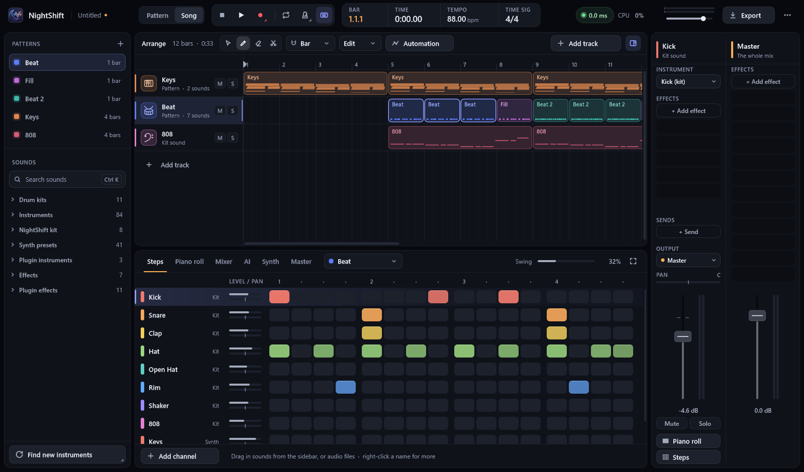

# NightShift: a free DAW for Windows and Mac

NightShift is a free, open-source DAW (digital audio workstation) for Windows and Mac: a pattern-first music
studio in the spirit of FL Studio, with a step sequencer, piano roll, playlist, mixer, synths, drum kits,
recording, VST3 and Audio Unit plugins, and an AI band (drummer, bassist, guitarist, keys and synth player)
that writes parts in the style you describe. No account, no trial, no ads.
**Website: [michaeldedmondson-design.github.io/nightshift](https://michaeldedmondson-design.github.io/nightshift/)**

Built in C++ on [Tracktion Engine](https://github.com/Tracktion/tracktion_engine) 3.5 and JUCE.



## Download

NightShift is free. Get it from the **[latest release](https://github.com/michaeldedmondson-design/nightshift/releases/latest)**:

- **Windows 10 or 11 (64-bit):** `NightShift-Setup-<version>.exe`. Run it: it installs just for you, with
  no admin password. The setup isn't signed (signing costs money), so Windows may say "Windows protected
  your PC": click **More info**, then **Run anyway**.
- **Mac with Apple Silicon (M1 or newer, macOS 11 or later):** `NightShift-<version>-mac.pkg`. Double-click
  it. It isn't signed by Apple (that needs a paid developer account), so the first time macOS won't open it:
  click **Done**, open **System Settings > Privacy & Security**, scroll down to the line about NightShift,
  click **Open Anyway**, and run the installer. It puts NightShift in Applications.

Both include the NightShift plugins, which other music apps can use too: **Lofi** (Cassette, Vinyl, Crush,
Haze), **Bass** (Drive, Split) and **Nightshift Drums**. Their source is in
[nightshift-lofi](https://github.com/michaeldedmondson-design/nightshift-lofi),
[nightshift-bass](https://github.com/michaeldedmondson-design/nightshift-bass) and
[nightshift-drums](https://github.com/michaeldedmondson-design/nightshift-drums). The studio drum kits, the
grand piano and the orchestra are free downloads NightShift fetches the first time you ask for one; the
808 and 909 kits and the synth sounds are built in, so you can start straight away.

Copyright (C) 2026 NightWriter. NightShift is free software: you can redistribute it and/or modify it
under the terms of the GNU General Public License as published by the Free Software Foundation, either
version 3 of the License, or (at your option) any later version. It is distributed in the hope that it
will be useful, but WITHOUT ANY WARRANTY; without even the implied warranty of MERCHANTABILITY or FITNESS
FOR A PARTICULAR PURPOSE. See the GNU General Public License ([LICENSE](LICENSE)) for more details.

## What works (v0.1)

- **Starting** (part Logic's project chooser, part FL's templates) – NightShift opens on "What do you want
  to do?": template cards on the left (Empty project, Beat, Songwriter, Band, Electronic: a track per part,
  each with its instrument or an audio track to record into, at the style's tempo; the first audio track
  armed), and Open a project, the recent ones and the demo song on the right. Close it (the cross or Esc)
  for a blank project: one empty track. New (Ctrl+N) brings it back. A switch on it says whether it shows
  when NightShift opens; opening a project file with NightShift skips it.
- **Donations** – NightShift is free. The first time the start screen shows (as a rule, NightShift's first
  open after installing), a banner across its foot says so and asks for a donation: **Donate** opens the
  page in the browser and the banner says thank you; **No thanks** takes it away. It never asks by itself
  again (the option nsDonationAsked remembers). **About NightShift** (the ⋯ menu) always has
  **Donate...**, beside the keys and the credits. The page is `donate::url` in `src/ui/Donate.h`:
  [paypal.me/Exfilbravo](https://paypal.me/Exfilbravo), also behind the Sponsor button on GitHub
  (`.github/FUNDING.yml`). Left empty, every Donate (the banner and About's button) is hidden.
- **Recording, FL's way** – the Record button in the top bar arms recording (tinted red); then Play (Space)
  records, and Space again stops. Record stays armed after Stop, so Space records the next take too, until
  you click Record off. What it records: what you play (the computer keyboard) on the selected instrument channel,
  and every armed audio track. In pattern mode notes go into the current pattern as it loops; in song mode
  (FL's way) into a new pattern whose clip lands where playback started (the current pattern if it's empty
  and not on the Arrange yet), straight on past the song's end, or round the loop if one's on. Audio takes
  go into the Arrange in song mode (Record switches to it). Arming Record while playing punches in at once
  (notes; audio in song mode with the loop off), and disarming punches out while it plays on. Right-click
  Record (or Menu > Recording) for FL's options: the countdown before recording (off, 1 or 2 bars; the
  metronome counts it, on or not), **start when I play the first note** (Space waits, and the first note
  starts the take on its first beat), **blend** (on: a take keeps the notes already in the pattern; off: it
  replaces the channel's), and what notes snap to (the piano roll's snap; Off keeps them as played). A
  note played in the count-in, more than half a step before the one, isn't kept.
- **Audio tracks** – Add track > *Audio track* > Guitar, Bass, Vocals or Other (or arm Record and press Space
  with nothing to record into: the first take makes one on input 1, armed); it's on Arrange at once, with its
  arm button. Each audio channel has an arm button, an input picker, a MON
  switch and an input meter. Takes land in the playlist as waveforms you can drag (by beats; Shift for bars,
  Alt for steps) or right-click to remove. Files go in `<project> Audio` beside the saved project, or
  `DocumentsNightshiftRecordings` before it has a name.
- **Metronome** (after Neural DSP's) – the metronome button in the top bar switches it on and off (Ctrl+M);
  right-click it (or its corner, or Menu > Metronome) for its panel: a light for every beat of the bar that
  flashes as it plays (click one to cycle its accent: strong, normal, soft, off; right-click for the list and
  a reset), the tempo with - and +, drag and **Tap** (the interval of your last two taps), the time signature
  with its groupings (7/8 as 2+2+3, 3+2+2 or 2+3+2, 5/4 as 3+2 or 2+3 and so on: the groups set the accents),
  the **rhythm** (beats, 2 a beat, triplets, 4, 5 or 6 a beat, swing, dotted, gallop, reverse gallop), the
  **sound** (Classic, Woodblock, Sticks, Clave, Cowbell, Hi-hat, Beep: synthesised, the downbeat its own
  sound, not just louder), **volume** and **pan** knobs, the count-in, only while recording, and **Practise**:
  the metronome on its own with the song stopped (Play takes over from it). The tempo and time signature are
  the song's; the rest is remembered with the app, the accents per time signature. It plays after the master:
  the master's effects, limiter and meter never hear it, and exports never contain it.
- **Takes and comping** (like Logic's take folders) – drag along the top strip of the playlist ruler to set
  a loop; song mode plays it round, and recording in it makes a take every pass (one file, sliced per pass;
  a pass cut short by Stop is kept if it has a second in it). Recording over a folder again adds takes to it.
  Click a folder's arrow (or double-click it) to show a lane per take; drag across a lane to use that part
  of the take (Quick Swipe Comping), click a lane to use all of it, right-click a lane to delete it or keep
  only the comp. Joins get a 10 ms equal-power crossfade. Click the loop strip to switch the loop off.
- **Low latency** – built around the Arturia MiniFuse 2 on its ASIO driver (MiniFuse Control Center), opened at
  32 samples: 2.2 ms in + 3.5 ms out = 5.7 ms round trip, measured. While an armed track monitors, plugins that
  look ahead (the master limiter) leave the graph so they add nothing. Takes are placed using the driver's
  reported latency and the backing's own delay; `--rectest` checks this to the sample. The toolbar shows the
  driver and round trip; click it (or F10) for Audio settings. With the MiniFuse's direct monitoring on you hear
  your instrument with no delay at all; MON is for hearing it through Nightshift's effects.

- **One window, our own look** – a top bar (Pattern | Song, transport, bar/time/tempo readouts, the interface's
  latency, CPU, master meter and volume), a sidebar with the song's
  patterns and a searchable list of sounds, Arrange on top and the editor underneath with Steps, Piano roll,
  Mixer, AI Drummer and Synth as tabs. Drag the gap between them to resize; F5 gives Arrange the whole height,
  F6/F7/F8/F9/F11 open each tab. The design is in `design/` (mockup.html, its
  renders, and a snapshot of each round as built).
- **Computer keyboard as a music keyboard** (on from the start; Shift+M or the keyboard button in the top bar
  switches it, and the choice is remembered) – the top two letter rows are laid out like a piano's keys:
  A S D F G H J K L ; ' are the white keys from middle C (C5), and above them W E, T Y U, O P and ] the
  black ones, up to F#6. Q, R, I and [ sit where a piano has no black key and do nothing. Z and X move the
  octave, C and V the velocity (1, 20, 40 ... 100, 127); a held key holds its note, chords too. Plain keys
  are all music: every shortcut takes Shift, Ctrl or Alt (Shift+L pattern / song, Shift+I the Inspector),
  apart from Space (play / stop) and the F-keys. With Record armed, Space records what you play (see
  Recording): each note timed by what you heard (the output latency taken off) and snapped; playing the same
  note on the same step again replaces it. A take is one undo. Typing into a text field never plays notes. It reads the keys
  itself, so it plays with a plugin's window in front too (as FL's typing keyboard does), and that window
  passes on the keys the plugin doesn't use; clicking anywhere outside a text field gives the keys back to
  the studio. The keyboard button lights up while notes are held.
- **Sounds** – in groups (Drum kits, Instruments, NightShift kit, Synth presets, Plugin instruments,
  Effects, Plugin effects), all shut when NightShift opens; click a group's name to open it. Plugin
  instruments and Plugin effects are by developer (A to Z, one that doesn't say last; "Valhalla DSP, LLC" is
  Valhalla DSP, and a developer's tooltip gives its whole name), every developer shut too until clicked (one
  that makes both opens in each group apart); Add channel's and Add track's Plugin instrument, and + Add
  effect, have a submenu per developer. Ctrl+K jumps to
  the search, which shows every match whatever's shut (a developer's name finds all its plugins); type, pick a match with Up/Down, Enter adds it as a channel. Or
  double-click a sound, or drag it into Steps (the editor switches to Steps when a drag starts) or onto
  Arrange. **Patterns** above them: click one to edit it, drag it onto a track in Arrange to put it in the
  song there, double-click to rename, right-click for Clone and Delete.
- **Inspector** (as in Logic) – down the right: the selected channel's strip beside the master's. A channel
  strip shows its name and type, its instrument (click: a plugin's window, or the sample / preset menu) or an
  audio track's input, arm and MON, every effect in its chain, its sends and output, pan, a fader with its
  meter and dB readout, Mute, Solo, and Piano roll / Steps buttons. Click a track in Arrange, a clip, or a row in Steps to select
  its channel; the selected track in Arrange and row in Steps are lit periwinkle. A drum track (several
  channels) shows the drum already selected, else its first; right-click > Select channel picks another.
  The panel shows itself in windows 1280 px wide or more; Shift+I (or the button at the right of Arrange's header)
  shows or hides it.
- **Double-clicks** (as in FL) – a pattern clip opens it in the piano roll on the channel playing its melody
  (the selected one if it does), or in Steps if it's all drums; a track's or channel's name opens its plugin's
  window, or its notes in the piano roll (a melody) or Steps (a drum), on a pattern it plays in. Rename is in
  the right-click menus, and F2 renames the selected channel.
- **Mixer** (F9, the editor's third tab; as in Logic) – a strip per channel in Steps' order, then the buses,
  then the master pinned on the right; it takes the editor's whole height (and the Inspector steps aside)
  until you leave it. Strips scroll sideways. Each channel's **Output** plays into the master or a bus; its
  **Sends** feed buses as well (drag a send sideways for its level, double-click for 0 dB, right-click for
  before the fader or to remove it). + Send offers a new reverb or delay bus, made with that effect all wet.
  **Buses** (+ Bus at the end of the row; right-click a bus's name to rename, recolour or delete it) have
  effects, pan, a fader, mute (which silences what plays into it, sends included, as in FL) and solo (only
  what plays or sends into it). Deleting a bus puts its channels back on the master.
- **Stock effects** – Nightshift's own, always there with no scan, each with its own panel: **EQ** (high and
  low pass at 12 or 24 dB/oct, two shelves and three bells, drawn over an analyser; drag a band's dot,
  wheel for Q, double-click to flatten), **Compressor** (threshold, ratio, soft knee, attack, release,
  makeup or auto makeup, mix, a high pass on what it listens to, its curve, in / gain reduction / out meters
  and a history; **sidechain** to any channel, e.g. a kick ducking the bass), **Reverb** (eight-line
  feedback delay network: size, decay, damping, pre-delay, low cut, width; Room / Plate / Hall / Cathedral
  starting points), **Delay** (in time with the song in note values, dotted and triplet, or in ms; feedback,
  ping-pong, filtered repeats, wobble, width), **Chorus** (rate, depth, delay, feedback, width) and **Filter**
  (low / band / high pass, 12 or 24 dB/oct, resonance, drive; drag the dot on its curve). Their parameters
  are automatable Tracktion parameters, saved with the project.
- **NAM Amp** (a stock effect) – a real amp, captured: **Load amp...** takes a Neural Amp Modeler model (`.nam`,
  thousands free at tonehunt.org), run by NAM's own core (WaveNet, LSTM and the newer architectures), and **Load
  cabinet...** a speaker cabinet's impulse response (`.wav`) for a model of the amp alone. Input, a noise gate in front
  (as NAM's plugin has), output, and **Even out loudness** (each model brought to -18 dB by the loudness it says it
  has, so swapping amps doesn't jump). A model trained at another rate than the song's runs at its own between NAM's
  resamplers (and tells the engine their delay); a standard WaveNet takes about a tenth of a core. Its panel says which
  amp it is (name, gear, kind of tone, who captured it); the files' paths are kept in the song, and a missing one is
  named. Put it on an audio track with a guitar or bass plugged in (monitoring on) to play through it.
- **Effects** – stock or any VST3 (the Nightshift Lofi four included) goes in a channel's chain, after its
  instrument (or straight off an audio track's input), a bus's, or the master's before the limiter.
  Double-click one in the sidebar's Effects or Plugin effects to put it on the selected channel, drag it onto
  a channel in Steps or onto a strip in the Inspector or mixer, or use + Add effect there (plugins in a submenu
  per developer); its window opens.
  On a strip, an effect's light switches it on and off, a click on its name opens its window, right-click
  moves or removes it. Steps rows with effects also show FX and a count. Settings are saved with the project.
  The scanned plugin list is written to %APPDATA%\Nightshift\Plugins.xml the moment a scan changes it (and
  read back at startup).
- **Steps** (the channel rack) – 16-step sequencer per channel, its pads lit in the channel's colour (brighter for
  harder hits). Click a channel's colour swatch to mute it (right-click to solo); drag the slim bars for level and
  pan (double-click resets). The pattern being edited and swing sit in the editor's header. Channels that hold
  melodies show a note preview instead of steps; click it for the piano roll. Drop audio files on it to add samples.
- **Piano roll** – click to add, drag to move, drag the right edge to resize, right-click to delete,
  velocity lane, ghost notes from the pattern's other melodic channels. Its controls sit in the editor's header:
  the channel picker (the channels with notes in the current pattern first, drums included), the pattern, the
  Select / Draw / Erase tools, **Edit** and **Quantize**, and snap (1/16, 1/32, beat, bar, off).
- **Editing** (the piano roll and Arrange alike; Ctrl is Cmd on a Mac) – click a note or clip to select it,
  Shift+click to add or take one away, or drag a box over them with the Select tool (Ctrl+drag with any tool);
  Ctrl+A selects all, Escape lets go. What's selected moves together (and, in the piano roll, stretches
  together; a selected stem in the velocity lane moves every selected velocity by as much). Ctrl+C, Ctrl+X and
  Ctrl+V copy, cut and paste: a paste lands where the mouse points, else right after what was copied; Ctrl+B
  duplicates the selection right after itself (a bar later for a bar's worth, the next beat for a hit); Delete
  deletes; Left and Right move it a snap step. Notes: **Ctrl+Q** quantizes the selected notes' starts onto the snap
  (every note when none are selected; a toast says how many moved); Up and Down move them a semitone, Shift with
  them an octave. Clips: drag either end to trim (a pattern clip then plays part of its pattern; a recording
  grows back as far as its takes have audio); the **Split** tool (scissors) cuts a clip where it's clicked and
  **Ctrl+T** cuts the selected clips (with none selected, every clip) at the song position, in Song mode; a split
  clip plays the notes that start in its part, as in FL. A recording's two dots on its top corners drag out its
  **fades** in and out. The **Edit** buttons in both headers list all of it with the keys; everything undoes.
- **Automation** (as in Logic; Song mode plays it) – the **Automation** button in Arrange's header shows a lane
  under each channel's track (its volume to start with) and the master's along the bottom. Click a lane to add a
  point, drag points to move them (on the snap; Alt finer), right-click one (or click it and press Delete) to
  delete it; the line runs straight from point to point, level before the first and after the last. A lane's
  name opens its menu: **Add a lane for** any of the channel's controls (pan, its sends, the instrument's and
  every effect's knobs, a plugin's parameters too), clear its points, or remove it. Right-click a fader, the pan
  bar, or a knob on NightShift's own effects or Nova and choose **Automate** to open its lane. A lane with no
  points leaves its control alone, and Pattern mode leaves every control where it is. A track playing several
  channels' patterns (a drum pattern of many sounds) has no lanes of its own: automate one of its sounds from its
  fader or a knob and it gets a track of its own. Buses can't be automated yet.
- **MIDI keyboards and controllers** – plug a USB MIDI keyboard in (or one on an audio interface's MIDI in) and it
  plays the selected channel straight away, through its instrument and effects: velocity, the sustain pedal, and
  pitch bend and the mod wheel on Nova and plugin instruments. With an audio track selected it keeps playing the
  last instrument. A **MIDI** light in the top bar flashes as notes come in (click it for Audio settings), and one
  plugged in while NightShift runs says so ("MIDI keyboard ready"). With Record armed, Play records what you play
  into the pattern as the computer keyboard does, each note where you played it (allowing for the moment notes take to
  arrive); a note held by the pedal is written as long as it sounded. **Audio settings** (F10) lists each MIDI
  input with a switch to turn it off. **MIDI learn**: right-click a fader or a pan bar (Mixer or Inspector) or a
  knob on NightShift's effects or Nova, choose *Link to a knob on your MIDI controller...*, and move the knob: it
  drives that control from then on (one knob per control, one control per knob; Escape stops waiting). Links are
  saved with the song, and the same menu forgets one.
- **Tempo and time signature changes** (Logic's tempo and signature tracks; Song mode plays them) – right-click
  Arrange's ruler: *Change the tempo here...* (jumping to it there, or gliding to it from the tempo before) or
  *Change the time signature from bar N* (from that bar's start; the bar before ends there, short if it has to). The
  ruler tags each change, blue for a time signature and amber for a tempo, and the menu deletes the ones in that bar.
  With **Automation** on, a **Tempo** lane runs along the top: click to add a change at that tempo, drag a point
  (on the snap; up and down for its tempo, Alt for tenths), double-click it for its dialog, right-click it to glide to
  it or delete it. **TEMPO** and **TIME SIG** in the top bar show what's playing where the song is (along a glide, the
  tempo in between) and change that; TIME SIG's menu also starts another time signature from the bar the song is in.
  Bars are as long as their time signature makes them, and snapping, the bar.beat display, the metronome's beats and
  accents, the count-in (the bars before the record start, as they play), recordings and automation all follow; a
  recording's length stays real time. Patterns keep a time signature of their own (FL's pattern time signature):
  right-click one in the sidebar > *Time signature*, or Pattern mode's TIME SIG > *Only for ...*; one made (F4) or
  recorded in Song mode where the time signature isn't the start's takes that one. Steps and the piano roll show the
  pattern's bars, and Pattern mode clicks in them, at the start's tempo.
- **Arrange** (the playlist) – only the tracks you've added, no empty rows waiting. **Add track** (in its
  header, and under the last track) offers everything a channel can be: the AI drummer, an audio track (Guitar,
  Bass, Vocals or other), a drum kit, a sampled instrument, a sample, a Nova sound or a plugin instrument, each
  as a new track (right-click a track > *Add a track under this one* to put it there), or an empty track for
  patterns. **Drag a sound** in from the sidebar, or a channel from Steps: under the last track or on the line
  between two it gets a new track there; on an instrument's track it replaces that instrument (its notes,
  effects and levels stay, Ctrl+Z puts it back); on a drum pattern's or an audio track it gets a track of its
  own just under; on an empty track it goes on that track; an effect goes on the track's channel. A highlight
  says which before you let go. **Drag a pattern** from the sidebar's Patterns onto a track, as in FL: a clip of
  it goes in where you let go (snapped; Alt finer; over the track names, at the left of the view), shown
  see-through with "Beat 2 on Drums at bar 5" before you let go. Under the last track it gets a new track; an
  audio track takes no patterns, so there it gets a new track just under. Ctrl+Z takes it out again. A track added for a channel takes its name (renaming one renames both) and
  icon, and that channel's recordings and new patterns land on it (or on a new track just under when it's
  busy). **Icons**: drums, guitar, bass, keys, synth, vocals, strings, brass, woodwind, audio, pattern – picked
  from what the track plays, or click the icon to choose. Draw on an instrument's track paints its own pattern
  (the current one if it's that instrument's, else the track's nearest, else a new one named after it);
  anywhere else the current pattern, as in FL. Drag a clip under the last track for a new track (it goes again
  if you drag back). Double-click an instrument track's empty space with Select for a clip there, opened.
  Right-click a track: rename, icon, mute/solo, add a track under it, delete it (or it and its channel). Tools
  in its header: Select (moves, never paints), Draw, Erase; and Snap (bar, beat, 1/16, off; Alt goes a step
  finer). Each track has mute and solo, plus an arm button on audio tracks. With the loop on, Play starts at
  the loop's start and Stop returns there. Projects from before keep their used rows as tracks.
- **Instruments** – sampler (any WAV/AIFF/FLAC/OGG/MP3), **Nova** (below), sampled instruments (below), and
  VST3 instruments (each scanned out of process so a bad plugin can't crash the app). Plugins installed
  since NightShift last looked are found by themselves when the studio opens (just those), and a note in
  the corner names them. **Find new instruments**, at the bottom of the sidebar's sounds, does the same
  whenever you like (say, just after installing one): it says it's looking, then names the new
  instruments (and effects), opens Plugin instruments and their developers to show them (the start-up look only names them,
  leaving the groups shut), or says nothing new turned up. Pressed while the start-up look is still going,
  it waits for that one. The same is **Find new instruments and effects** in the ⋯ menu and in Add
  channel's and the effects' menus. Right-click the button (or the ⋯ menu's **Plugin list and folders...**)
  for the full plugin list, to add a folder of your own. The words on screen are for beginners: no
  "VST3", no "scan".
- **Menus** – every menu (right-click and the rest) is drawn by NightShift's look: 17.5 px text in 34 px
  rows, greyed-out items still readable, headings bold above their items, shortcuts right-aligned
  (`NightLookAndFeel` in `ui/Theme.cpp`; `--menupreview menu.png` draws a sample one).
- **Text you can read** – nothing anywhere under 15 px, everyday words at 16, the small capitals over readouts and
  sections (BAR, TIME, INSTRUMENT) at 14, and the faint grey bright enough (4.5 to 1 or better) on every surface; a
  greyed-out control's words still 3 to 1. A label that can't fit shows "..." rather than losing letters, and a
  header's button that's squeezed out of room shows its icon alone (its tooltip says the rest). `--texttest` holds
  every view to it. The Lofi and Bass plugins' windows show their designs a quarter bigger, whole, for the same.
- **Nova** (a synth channel; the editor's **Synth** tab, F11) – Nightshift's own synth: two oscillators that
  morph sine > triangle > saw > square (PolyBLEP and PolyBLAMP keep them clean up high), each with up to eight
  detuned unison voices spread in stereo; FM (osc 2 bending osc 1), a sub an octave down and noise; a
  state-variable filter (low, band, high pass or notch; 12 or 24 dB/oct) with drive, its own envelope, key
  tracking and velocity; amp, filter and mod envelopes; two LFOs (six shapes, free or in time with the song,
  per note or free-running, with fade-in); a six-slot mod matrix (ten sources to nineteen destinations);
  poly (16 voices), mono or legato with glide and pitch bend; then drive, chorus, a ping-pong delay in time
  with the song and an eight-line reverb. The tab shows every control over five pages (Oscillators, Filter,
  Motion, Mod matrix, Effects), each section drawing what it does (the wave, the filter's curve and how far
  its envelope reaches, each envelope, each LFO), and dims what does nothing as things are set. 40 factory
  sounds in nine categories (Keys, Pad, Lead, Bass, Pluck, Bell, Brass, Arp, Texture: Velvet Keys, Dusty
  Rhodes, Wurli Bite, Drawbar Organ, Clav Funk, Night Pad, Aurora, Supersaw Lead, Acid Line, Reese, Wobble
  Bass, 808 Bass, Kalimba, Crystal Bell, Synth Brass, Space Drone...), levelled to sit within a couple of
  dB of each other; pick one from the sidebar's Synths, the tab's arrows and menu, or a channel's Sound
  menu. A channel named after its sound follows it. Every setting is an automatable parameter saved with
  the project; a song saved with the old synth (Tracktion's 4OSC) still plays it until a Nova sound is
  picked.
- **Nightshift Guitar** – an electric guitar played by modelling its strings, no samples: each note a string
  (a tuned delay line with its losses, the string's stiffness, where it's picked and where the pickup sits, a
  pluck shaped by how hard), then an amp (a tight high-pass and a mid push before the drive on the heavy
  sounds, stages of drive, a tone stack, a cabinet, a touch of room). Eight sounds: Clean, Jazz Box, Funk
  Clean, Lofi Clean, Crunch, Punk, High Gain and Djent (the last two double-tracked, a second take panned
  opposite), each levelled to about -18 LUFS. Played like a guitar from MIDI: a note goes on a string by
  itself, a new note on a busy string replaces the old one; C0 held palm-mutes the notes that start under it,
  C#0 makes them dead notes (a scratch); a note that starts while another on its string still sounds is a
  hammer-on (2 semitones or less) or a slide. A channel plays it from the sidebar's Instruments ("Guitar,
  High Gain"...) or the Inspector's instrument chip; about 38 times faster than real time on the heaviest.
- **Sampled instruments** – any SFZ instrument, played from disk (memory-mapped, the start of every sample
  read in ahead): velocity layers, round robins, keyswitches, loops, release samples, the sustain pedal,
  choke groups. Get the piano and orchestra (Add channel > Instrument, or the sidebar's Instruments) fetches
  the [Salamander Grand Piano](https://github.com/sfzinstruments/SalamanderGrandPiano) and the [Versilian
  Studios Chamber Orchestra 2 (Community Edition)](https://github.com/sgossner/VSCO-2-CE): 76 instruments
  in Keys, Strings, Brass, Woodwinds and Percussion (2.9 GB to download, about 5 GB once unpacked, in
  `%LOCALAPPDATA%\Nightshift\Instruments`).
- **Built-in kit** – kick, snare, clap, hats, rim, shaker and a C2-tuned 808, synthesised on first run into
  `%APPDATA%\Nightshift\Kit` (24-bit, 48 kHz).
- **Drum kits** – a kit is one channel, its notes named by drum in the piano roll; add one from the sidebar's
  Drum kits or Steps' Add channel > Drum kit (or let the AI drummer pick). They live in
  `%APPDATA%\Nightshift\Kits` as SFZ, and play with velocity layers, alternate takes picked at random (never
  the same one twice running), the hi-hat choke, cubic resampling and 3 dB of headroom.
  - **Studio kits** (Get the studio drum kits, 10.5 GB once, from the AI tab's Drums banner, the sidebar or
    the Add channel menu): the [DrumGizmo](https://drumgizmo.org) kits, each drum recorded on all of a kit's
    13 to 16 mics. **Crocell** (a metal band's kit: double kick, four toms, three crashes, two chinas, two
    splashes), **Muldjord** (a Tama Superstar for heavy rock and metal), **DRS** (Paiste cymbals, jazz to
    rock) and **DRS Brushes**. Nightshift downloads each (to `%LOCALAPPDATA%\Nightshift\Downloads`, carrying on
    from where a cut-short download got to) and mixes every hit to stereo once: overheads and room where they
    sit, each close mic panned to where its drum is in the overheads, kick and snare centred, bleed 6 dB down,
    polarity checked between a drum's own mics, close mics set a few dB over the overheads; tails cut at
    -70 dB; up to 24 hits a drum (12 for cymbals) across its dynamics, in layers of three takes; each drum at
    the level a sample library sets it (kick and snare -1 dBFS at their hardest, toms -2, crashes -4, ride
    -8, hats -10). Then the zip is deleted. Big zips are ZIP64, read by Nightshift's own `ZipReader`.
  - **Nightshift 808 and 909**: synthesised, always there, written on first start: a long 808 boom with a
    beater click, two-tone snare and snappy noise, four-hand clap, the six-square metal through two
    band-passes for hats and cymbal, toms, cowbell, maracas, claves; the 909's swept, saturated kick, brighter
    snare, metal-and-noise hats, crash, and a ride with bell partials. Three layers that change the tone
    (harder hits brighter), two takes each.
  - **Drum kit from a folder** (sidebar, Add channel > Drum kit): any folder of one-shots, a free sample pack
    say. Each sound goes on the drum its file or folder name says ("BD_Punchy_01", "Hats/OH 01", "Tom Lo"),
    several of a kind become takes, each set to the level the other kits play that drum; what wasn't named
    like a drum is left out and the report says so. A channel playing it opens with its drummer.
  - The older AVL kits (Red Zeppelin, Black Pearl, Blonde Bop...) still play if they're there.
- **AI drummer** – the AI tab's prompt, along its top (F8 opens it ready to type): describe a groove in words ("lofi jazz
  on brushes, lazy swing and ghost notes", "metalcore with a breakdown at 150", "trap, hi-hat rolls"), press
  Enter, and it's written at once, offline, on this computer: no internet, no account. Follow up in the same
  prompt to change it ("busier hats", "half time", "add a bridge", "faster", "straight"); the same words again
  give another take. With no drum kit yet it makes one, choosing the kit for the style; the chip beside the prompt
  says who it writes for (a selected drum kit becomes the one; click it to pick another or a new kit). The
  conversation, versions, sections and feel are in the AI tab's **Drums** (F8;
  double-clicking a kit channel opens it too), which shows ideas to start from before the first part.
  Each answer is a version: the arrows or a click on an earlier reply go back to it, and the next request
  builds on that one. A groove comes as sections
  (Verse, Chorus, Fill...), each written into an ordinary pattern named after the channel and section, so
  Steps and the piano roll edit it; the section chips open them and Put in Arrange lays out the drummer's
  arrangement. It can set the song's tempo and time signature, plays ghost notes, flams, drags, swing and a
  per-drum push or lay-back; Swing, Looseness and Dynamics rework the feel without asking again (As written
  goes back to the drummer's swing). Where the band has learned it, the feel is real drummers': learned from
  Google's Groove MIDI Dataset (13.6 hours of ten drummers), each style's swing, how far ahead or behind each drum
  sits, how loosely, and where each step of a bar lands and how hard (rock, hard rock, punk, pop-punk, funk,
  hip-hop, boom bap, jazz, ballads, reggae, afrobeats, bossa nova, country, and the pop, soul, gospel and disco
  genres; the programmed styles stay tight, and lofi and neo-soul keep their lazy pocket). It says so in its reply. Any channel can switch to another kit and keep its part. A VST3
  instrument channel gets an AI drummer (General MIDI) too, writing on the General MIDI drum map.
- **Genres and artists** – the whole AI band (drummer, bassist, guitarist, keys, synth, the song agent and the
  mastering engineer) plays 32 styles and knows 39 genres (alternative and progressive metal, post-hardcore,
  doom, emo, math rock, post-rock, shoegaze, grunge, blues, pop, trapsoul, R&B, soul, gospel, city pop, disco...)
  and about 340 artists ("make a Sleep Token style song", "like Nirvana", "a Future type beat"). Thirteen genres
  are styles of their own, every player with its own part: house (four on the floor under piano stabs), techno
  and dubstep (no keys: the synths have it), EDM (a snare roll building into the drop, chords on its offbeats),
  drum and bass (the two-step at 174 under Rhodes ninths), synthwave, reggae (the one drop, the guitar's skank,
  the organ's bubble, horn hits), reggaeton (the dembow, chords on its 3+3+2), afrobeats, bossa nova (the clave,
  Rhodes shells, a flute), ambient (no drums, a sparse piano over a drone), cinematic (toms in 3+3+2 under a
  piano ostinato) and country (the train beat, honky-tonk piano, boom-chick guitar). Any other genre is played
  as the style nearest it with its own feel on top: Sleep Token is alternative metal on the djent
  band at 140, piano verses with the guitars and bass out, crushing half-time choruses in drop C, soul chords on
  the keys. Any request can ask for it too: "soft verses", "a quiet intro", "heavy half-time choruses", "builds",
  "twelve bar" (the blues' changes, twelve bars a section), "soul chords", "four on the floor", "clean", "piano".
  A name it doesn't know ("zyx style") is said back, not played as rock.
  A one-word artist that's also a word (Ghost, Ride, Future, Death) counts only beside "like", "style", "type
  beat" or the like. The mastering engineer keeps a dynamic song's quiet parts quiet (its loudest squeezed 10 dB
  at most), stopping short of the loudness target and saying so.
  The drummer is a specialist per style (`src/ai/OfflineDrummer.cpp`), each playing as a session drummer
  who plays nothing else would:
  - **Metalcore & metal** (metalcore, deathcore, djent, thrash, death and black metal, metal): half-time
    breakdowns locked to a chug (6-3-3-4, 3-3-3-3-2-2...) with the china on the hits, double kick under
    the chorus, floor-tom builds, tom runs into the next section; hammer and bomb blasts; djent's kick
    cycle of 5 or 7 crossing the bar line under a half-time snare; thrash's skank beat; gallops.
  - **Trap & hip-hop** (trap, drill, boom bap, hip-hop): trap's half-time clap on 3, 808 kick motifs and
    hat rolls in 16th triplets and 32nds; drill's triplet hats and the snare on 3 and again off the beat;
    boom bap's swung 16ths and lazy snare.
  - **Rock & pop-punk** (rock, hard rock, pop-punk, punk): 8ths, the skate beat, punk's d-beat,
    fills and crashes where a section lands.
  - **Lofi, jazz & neo-soul** (lofi, jazz, jazz ballad, neo-soul): lofi's late, swung, ghosted pocket and
    rim clicks; jazz's ride (ding, ding-a ding, ding-a) on triplets, the hat pedal on 2 and 4, the kick
    feathered and the snare comping, brushes swept on ballads; neo-soul's Dilla feel, the kick early and
    the snare late.
  - **Funk** (funk, funk rock, disco funk): on the one, the kick hard there and syncopated after, never on
    the backbeat; 16ths on the hats leaning on the 8ths, the snare cracking on 2 and 4 with ghost notes round
    it, an open hat barking on an offbeat; linear grooves (no two limbs at once) when it's busier, a disco
    chorus (four on the floor, open hats on the offbeats), a pickup on the "a" of 4 and 16th fills round the
    toms into the one.
  - **Electronic** (house, techno, EDM, drum and bass, dubstep, synthwave): four on the floor with the clap on 2
    and 4 and open hats between (techno's sixteenths ticking), EDM's build of a snare roll rising in sixteenths
    and an empty beat before the drop, drum and bass's two-step at 174, dubstep half-time with its own build,
    synthwave's 80s kick on 1 and 3 under a big snare.
  - **Island and Latin** (reggae, reggaeton, afrobeats, bossa nova): reggae's one drop (the kick and side-stick
    together on 3, nothing on 1; rockers in a chorus) on swung eighths, reggaeton's dembow, afrobeats' kick off
    the beat under a clap on 2 and 4 and a shaker leaning off the beat, the bossa clave on the side-stick over a
    soft surdo kick.
  - **Ambient, cinematic and country**: ambient's no drums but a soft kick and ride in its biggest parts;
    cinematic's toms in 3+3+2 under a big snare, a tom roll building into it; country's train beat and two-beat.
  For each section it writes 20 candidate bars and keeps the one that best fits its style's rules, then
  plays them through the song: phrases of four bars with a variation on the fourth, a fill into the next
  section, a crash where it lands. With no sections named it plays the style's usual song ("trap": intro,
  hook, verse); "with a breakdown" adds one to it; a list ("intro, verse and chorus") is the song as asked.
  In a song with nothing else in it yet it sets the style's tempo (metalcore 150, lofi 80...); otherwise
  the song keeps its tempo unless one is asked for. It understands tempos ("at 140", "90 bpm"), meters
  ("in 7/8"), bars ("6 bars"), half and double time, brushes, blasts, ghost notes, gallops, double kick,
  heavier or gentler, busier or simpler (hats or kick on their own), and swing (straight, light, lazy).
- **The AI tab** – every AI agent in one place: the editor's **AI** tab lists them down its left side - **Song**,
  **Drums**, **Bass**, **Guitar**, **Keys**, **Synth**, **Master** - each with what it does, and shows the one picked
  beside the list (its conversation, versions and sections, as below), with the prompt along the top: picking one
  points the prompt at it (its hint, the chip for who it writes for), and each keeps its key (F8 drums, Shift+F8 bass, Ctrl+F8 guitar, Alt+F8
  keys, Ctrl+Shift+F8 synth, Shift+F12 master). In a short window the list keeps to the names.
- **AI song** – the AI tab's first agent: a whole song from one prompt. Describe it in the prompt ("metalcore song in
  drop C at 150", "dark trap beat with bells", "lazy lofi beat", "funk with horns, no keys", "jazz trio with a flute")
  and it starts a new project (asking to save this one first if it has changes), then the band plays it together:
  the drummer writes each of the song's sections once, the bassist plays the chords with the kick, then the
  guitarist, keys and synth players follow, each on a channel of its own with its style's sound and fader. Who plays
  is the style's band - metal's guitars (and metalcore's keys and synth), trap's 808, piano and bells, rock's guitars
  and keys, jazz's trio and a flute, funk's whole band with horns - and the words change it ("no keys", "with
  guitar", "without the synth"). The song's form is the style's (an intro and outro around verses and choruses;
  hooks first in trap, a breakdown in metal, a bridge in rock and funk, Head and Solos in jazz), 16-bar sections where
  8 would leave it all repeats, and more verses and choruses added before the last chorus until it lasts two minutes
  or more. It's all laid out in Arrange (the drums in the song's order, everyone under them), then the AI mastering
  engineer masters it for the style. It says what it made (the key, tempo, length, sections with their repeats, who
  played on what, how loud the master came out), with **Play from the top** and a button per player to open its
  agent and change its part; the prompt and what it made are saved with the project. Offline, like every agent.
  - **A song's vibe** – or give it a song to go by: **Listen to a song...** in the Song panel (or drop an MP3, WAV,
    AIFF, FLAC or Ogg file on it) and the band's ears listen to it, on this computer in a few seconds, nothing
    sent anywhere. They hear its tempo and beat (where its bars start, its swing, a kick on every beat, a half-time
    backbeat), its key and a chord a bar, its sections (where the music changes, which parts come back, how loud
    each is: intro, verse, chorus, bridge, outro), its drums and its sound (dark or bright, clean or gritty, how
    much low end), and the band's styles it's nearest. It says what it heard, offers its nearest three styles to
    **Play it as**, and **How close** to keep to it (Close: its tempo, key, chords and form as heard; Some changes:
    the tempo moves a little and a chord or two turns to a neighbour; Loosely: the key and the form may change too),
    with what the new song keeps and changes. **Write a song with this vibe** has the song agent make it: the band
    writes its own parts, so it's never a copy. The words it writes are the song agent's own ("funk at 104 bpm in
    E minor, 33% swing, verse chords Em7 Em7 A9 Em7, chorus chords A9 A9 Em7 Em7, form intro verse chorus verse
    chorus bridge chorus outro"), and anyone can type them: "verse chords ..." (or "chords ..." for every section)
    has the bassist, and everyone after it, play those chords, and "form ..." lays the song out that way. The
    styles it knows by ear it learned by listening to the band itself: every style rendered as a whole song three
    times and heard (`tools/vibes/learn_ears.js`, `src/ai/StyleEars.cpp`).
- **AI bassist** – the same prompt, switched to AI Bass (Shift+F8, or the AI tab's **Bass**): describe a bass
  line ("funk, slap the octaves", "metalcore in drop C, locked to the kick",
  "trap 808 with slides", "walking jazz bass in Bb") and it's written at once, offline, playing with the
  drummer: the same sections, bar for bar, locked to its kick, with its swing. With no drummer yet it plays to
  the drums its style would have and says so. With no bass channel it makes one, called Bass, on a sound
  chosen for the style (a Nova bass shaped for it: Picked Metal Bass, 808 Glide, Funk Bass, Round Upright,
  Neo Soul Moog...), levelled to sit a little under that style's drums (measured with `--bassrender`). The
  tab shows what was asked and what it played, each a version to step back to; the sound (any bass sound,
  a click away); the key; a chip per section (its pattern in the piano roll); and Put in Arrange, which lays
  the bass under the drummer's sections (the drums first, if they aren't in Arrange yet). It's a specialist
  per style, as the drummer is:
  - **Metal**: the low root doubling the chug, every kick of a breakdown, a b2 (deathcore's tritone) to lift
    the end of a phrase; root 8ths under the double kick; thrash's gallops; djent doubling the kick cycle;
    a chromatic walk into each riff. Never under a drop tuning's lowest string.
  - **Trap and drill**: the 808 on the kick, held to the next, nothing in the intro; up the octave (or a
    slide, on the gliding 808) to end a phrase; drill sliding between notes of the scale.
  - **Boom bap and hip-hop**: the root on the kick, a passing chord tone between, detached.
  - **Rock and pop-punk**: root 8ths (downpicked in pop-punk and punk), with the kick in a rock verse, a step
    into each chord and a walk into each part.
  - **Lofi, jazz and neo-soul**: lofi's warm chord tones with a chromatic step into each change; jazz walking
    quarters (the root on the one, chord and scale tones chosen as the smoothest way to a chromatic
    approach, the odd skip note) or in two for ballads; neo-soul's root pushed ahead of the one, slides into
    chord tones, ghost notes.
  - **Funk**: on the one, hard; the kick's notes; the octave popped on the offbeat 16ths, never on the
    backbeat; dead notes ghosting in; a step into the next one; disco octaves in a four-on-the-floor chorus.
  - **Electronic**: house's offbeat bass (or octaves bouncing), techno's rolling sixteenths between the kicks,
    EDM's pumping eighths saved for the drop, drum and bass's long Reese, dubstep's wobble leaving room for the
    snare on 3, synthwave's driving eighths with the octave on the offbeats.
  - **Island, Latin, ambient, country**: reggae's deep, melodic line round the drop on 3, the 808 on reggaeton's
    dembow, afrobeats bouncing between the root and the fifth, bossa's root and fifth on an upright, ambient's
    soft sub, cinematic's low sub, country's root and fifth.
  It plays each genre's progressions in a key: asked for ("in F# minor", "key of Bb", "dorian", "drop B"), or
  the style's own (drop C for metalcore, F minor for trap, E dorian for funk, Bb for jazz...). For each
  section it writes 20 candidate lines, each played through every bar, and keeps the one that best fits the
  style's rules: how much it locks to the kick and covers it, how many notes, the root on the one, the range,
  no wild leaps, the style's signature (drill's slides, funk's pops and dead notes). It also understands
  slides, walking, octaves, slap, a pedal tone, "locked to the kick", and long or short notes.
- **AI guitarist** – the same prompt, switched to AI Guitar (Ctrl+F8, or the AI tab's **Guitar**): describe a
  guitar part ("metalcore chugs in drop C", "funk chicken scratch in E", "jazz comping, the Charleston") and it's written
  at once, offline, over the bassist's chords and locked to the drummer (each imagined for the style when
  they aren't there yet, and it says so). With no guitar channel it makes one on the style's sound (High Gain
  for metal, Djent, Crunch for rock, Punk, Funk Clean, Jazz Box, Lofi Clean, Clean) with its fader where that
  style's mix wants it (measured with `--bandrender`: a wall of guitar level with the drums in metal, a
  little under them elsewhere). Every note has a string and a fret, so the tab shows the part as **tab** to
  learn: the strings named by their tuning, the chord over each bar, P.M. over palm-muted runs, x for
  scratches, h and / for hammer-ons and slides; a section chip shows its tab (right-click opens the pattern in
  the piano roll). Put in Arrange lays it under the drummer's and the bassist's sections. Its tunings: drop
  tunings on the key for metalcore and deathcore (drop C by default), a 7-string in B standard for djent,
  standard for the rest. A specialist per style:
  - **Metal**: palm-muted chugs on the open low string locked to every kick of a breakdown, the power chord
    ringing where a phrase starts, a b2 (deathcore's tritone) stab to end a phrase; verse riffs of chugs with
    notes up the neck answering; open power chords in the chorus; tremolo picking over blasts; thrash gallops.
  - **Rock and pop-punk**: palm-muted power-chord 8ths opening up in the chorus, the push into the next chord,
    octave chords in the bridge; rock's barre chords strummed down, down, up, up, down, up; hard rock's riff of
    a power chord and the pentatonic on the low strings.
  - **Trap, drill, boom bap, hip-hop**: a clean arpeggio up, down or both (in triplets where the bar is);
    jazzy stabs between the kicks.
  - **Jazz, ballads, lofi, neo-soul**: shells comped four to the bar or the Charleston; ballads broken a note
    a beat; lofi's soft rootless chords strummed up with notes picked after; neo-soul's ninths up the neck,
    pushed ahead of the one, with hammer-ons and slides.
  - **Funk**: the 16th chicken-scratch, the hand never stopping, ninth-chord stabs on the top three strings
    cutting through on the syncopations; disco chucks in a four-on-the-floor chorus; a single-note line in the
    bridge.
  - **The newer styles**: synthwave's chord picked in eighths, house's short chops on the offbeats (techno,
    EDM, drum and bass and dubstep leave it to the synths), reggae's skank on 2 and 4 (doubled in a chorus),
    reggaeton's plucks on the dembow, afrobeats' highlife in sixteenths, the bossa thumb on the root and fifth
    under the chord's shell on the off-beats, ambient swells, cinematic's power chord under the toms, country's
    boom-chick.
  The fingering keeps the hand near where it was, never splits a power chord over a skipped string (an
  octave chord does), and keeps a chord within five frets.
- **AI keys player** – the same prompt, switched to AI Keys (Alt+F8, or the AI tab's **Keys**): describe a keys
  part ("neo soul Rhodes, push the chords", "jazz comping, rootless voicings", "pop punk
  piano, pumping 8ths", "trap piano melody", "funk clav") and it's written at once, offline, over the bassist's
  chords and locked to the drummer (each imagined when missing, and it says so). With no keys channel it makes
  one called Keys on the style's sound: the sampled Grand Piano when it's been fetched (metal, trap, rock,
  pop-punk, jazz, ballads, house, EDM, reggaeton, ambient and cinematic; the upright piano for country), else a Nova sound (Felt Keys, Velvet Keys, Dusty Rhodes, Clav Funk, Drawbar
  Organ, a pad for deathcore and djent), its fader set for the style's mix (measured with `--bandrender`: 2 to 5
  dB under the drums). Every right-hand chord is led from the last (of all its inversions, the one whose notes
  move least). A specialist per style:
  - **Metal**: a piano arpeggio over the intro with the low octave ringing, big chords held under the chorus,
    a high bell or laying out in the verse, out of the breakdown's way (an eerie high b2 at most); a dark pad
    for deathcore, an ambient one for djent.
  - **Rock and pop-punk**: pumping 8th-note chords, octaves on 1 and 3; the organ held under hard rock.
  - **Trap and drill**: a dark piano motif of 4 to 7 notes, the same rhythm every bar, following the chords
    through their tones, held fifths in the left hand (drill's line with the b2 in it); boom bap's dusty Rhodes
    chords between the kicks.
  - **Jazz, ballads, lofi, neo-soul**: jazz comping in four-note rootless voicings (the Charleston, comping on
    2 and pushing the next chord, or sparse), the roots left to the bassist; ballads rolled slowly; lofi's
    felt piano rolled, the root held, a few notes answering; neo-soul's Rhodes ninths pushed ahead of the one,
    restruck on the syncopation, grace notes sliding into the top.
  - **Funk**: the clav, stabs on the syncopations and the left hand filling the 16ths between, never on the
    same 16th; clav chords on the off-beats in a four-on-the-floor chorus.
  - **Electronic**: house's short piano stabs on one of its rhythms (3+3+4+2+4, the offbeats...), out of the
    intro and held through the breakdown; EDM's chords on the beat, building through the prechorus, on the
    drop's offbeats, alone in the breakdown; drum and bass's Rhodes holding ninths; synthwave's held chords;
    none in techno or dubstep.
  - **Island, Latin, ambient, country**: reggae's organ bubble (a chord on each offbeat, a lighter one just
    after), reggaeton's chords on the dembow's 3+3+2 in the hook, afrobeats' two-bar syncopation, bossa's Rhodes
    shells (the third, seventh and ninth), ambient's sparse piano (a note or two a bar), cinematic's ostinato in
    eighths under the chord held high, country's honky-tonk (2 and 4, a slide into the third, a run down at a
    phrase's end, on the upright piano).
  The piano styles are played with some weight (a trap melody or a metal intro hit firmly).
- **AI synth player** – the last of the band: the same prompt, switched to AI Synth (Ctrl+Shift+F8, or the AI tab's
  **Synth**). Describe a synth part ("trap bell melody", "metalcore trance
  arpeggio", "djent ambient pad", "neo soul Moog lead with slides", "funk horn stabs") and it's written at once,
  offline, over the bassist's chords and locked to the drummer (each imagined when missing, and it says so). It
  plays one of four jobs, the style's own unless the words name one: a **pad** (chords held, each led from the
  last), an **arpeggio**, a **lead** (a melody built from a motif, repeated and answered, its strong beats on the
  chord's notes, coming home at the end of each phrase) or **stabs** (chords hit with the band). Words for a
  sound pick it too: bells, music box, flute, choir, strings, brass or horns, supersaw, pluck, harp, kalimba,
  Moog, chip, screamer, drone. With no synth channel it makes one named for the job (Synth Lead, Synth Pad,
  Synth Arp, Synth Stabs) on the style's Nova sound for it, its fader set for the style's mix (measured with
  `--bandrender`: a pad about 7 dB under the drums, an arpeggio 5, stabs 4, a lead 3). A sound that can't play the job (a one-note lead can't hold a chord, a slow pad can't play
  an arpeggio) is swapped for one that can, and it says so; a sound you picked otherwise stays. A specialist
  per style:
  - **Metal**: metalcore's trance arpeggio in 16ths over the intro and chorus, out of the verse and the
    breakdown; deathcore's choir, and a low choir drone under the breakdown; djent's ambient pad of add9 chords
    floating on over the chugs; strings for metal and thrash, spread wide, the root doubled under a chorus;
    trance stabs on the off-beat 8ths, hitting with a breakdown's long hits.
  - **Trap and hip-hop**: trap's bell melody, the beat's, one motif all song, the same rhythm every bar and
    turned around in the fourth, in the gaps the keys leave; drill's dark choir; boom bap's horn stabs, a call
    and a pickup answering it over two bars; hip-hop's pluck melody.
  - **Rock and pop-punk**: pop-punk's hook doubled in octaves in the chorus, answering at the ends of the
    verse's phrases; hard rock's 80s brass riff on the syncopations, the chord held through the chorus and the
    next pushed in an 8th early; rock's strings.
  - **Jazz, ballads, lofi, neo-soul**: jazz's flute line in swung 8ths, chord tones on the beats, approached from
    a half step away; ballads' strings; lofi's lazy lead behind the beat, a phrase and a breath; neo-soul's
    Moog-style lead (Mono Lead, gliding) sliding and scooping into its notes, ninths and elevenths.
  - **Funk**: the horn section: short stabs on the syncopations between the kicks (rootless ninth voicings), a
    riff in octaves on the blues scale in the chorus, held chords swelling in the bridge.
  - **The newer styles**: house's warm pad, techno's sequence, EDM's supersaw lead (level with the drums in the
    drop), drum and bass's breathy pad, dubstep's dark one, synthwave's arpeggio, reggae's and afrobeats' horn
    hits answering on the offbeats over two bars (afrobeats' own job a kalimba arpeggio), reggaeton's pluck,
    bossa's flute, ambient's drone, cinematic's strings, country's strings.
  A legato lead is played one note at a time and runs on into its slides, so it glides.
- **Time signatures** – 4/4, 3/4, 2/4, 5/4, 6/4, 7/4, 6/8, 9/8, 12/8, 5/8, 7/8, 11/8, 13/8, 7/16, 13/16, 15/16:
  click the time signature in the top bar or use the main menu. Steps shows a bar's worth of 16ths grouped by
  beat, Arrange's ruler, snap and the piano roll count in it, and it's saved with the project. One per song.
- **AI mastering** – the AI tab's **Master** (Shift+F12 opens it ready to type in the prompt;
  the Master tab's *Let the AI master it...*). **Master it** (or words: "loud metalcore master", "warm, for Spotify", "less harsh", "punchy
  and wide") and an offline mastering engineer listens to the whole song as it comes into the master (raw: no
  shaping, no push) and hears how loud it is, its peaks, how its tone balances (the low end, body, presence
  and air, each per octave against the mids), how much room its peaks take over its body, and how wide it is
  (the sides, the bass on the sides, how it holds up in mono). It masters for the song's style (the words',
  else the AI drummer's), the way that style's masters sound - metalcore dense and bright with the low mids
  clean, trap's 808 big and centred with the hats crisp, lofi warm and dark, jazz left to breathe at -16 for
  Apple Music - and sets the Master tab: **Tone** (a band only moved where it's further from the style's
  balance than masters differ, and gently: no more than 3 dB, the top never boosted past +3; bass boosted in
  the centre, air on the sides for the wide styles), **Punch** (the style's, more when the peaks have lots of
  room, less when it's dense), **Width** (the style's, less when it's wide already; the bass kept in the
  middle for metal, trap and club styles, or wherever it wanders) and the loudness target. It checks its tone
  by hearing the mix through the moves alone and corrects a band that moved more or less than it meant, works
  out the push into the limiter (with the shaping, from the raw capture), and if the target can't be reached
  cleanly tries again denser (more Punch, less low-end boost) - or says where it stops and why. It says what
  it heard and did; each answer is a version to step back to (saved with the song, undoable). Follow-ups move
  on from the settings as they are (knobs turned since included): warmer, darker, brighter, less harsh, less
  mud, more or less bass, more or less punch, wider, narrower, louder, quieter, for Spotify, Apple Music or
  Loud, "master it again". Down the side: the style and target, loudness and peaks before and after, the
  tone against the style's (the range masters fall in shaded; before as a ring, after as a dot), and
  **Listen**: *Mastered*, *Before* (the mix, no shaping, no push) or *After* (the master turned down to the
  mix's loudness, so you hear what changed, not only that it's louder). An export is always the master.
- **Master** (the editor's **Master** tab, F12) – getting a song ready to put out, in plain words. **What is it
  for?**: *Just keep it from clipping* (the default, as before), *Streaming* (Spotify, YouTube, Tidal,
  Amazon: -14 LUFS), *Apple Music* (-16) or *Loud* (SoundCloud, clubs, beat stores: -9). **Set loudness**
  plays the whole song through once as it goes into the limiter (a capture: after the master volume,
  before any push), then works out on a thread of its own how hard to push it into the limiter to land on
  the target (a few passes over the capture, to 0.1 LU), says what it did ("it was -12.9 LUFS, now -14.0
  ... Pushed 1.2 dB louder"), and warns when the limiter has to squeeze the loudest parts by more than
  6 dB. As it plays: **Now** (the last 3 seconds), **Whole song** (since Play; green within 1 dB of the
  target), **Peak** (true peak, red over the ceiling) and **Range** (quiet to loud), the last 30 seconds as
  a graph against the target, and the knobs **Louder** (the push, -12..+24 dB) and **Never above** (the
  ceiling, -3..0 dB) with how hard the limiter is **squeezing**. All saved with the song (`mastering`),
  undoable. The meter is Tracktion's EBU R128 / BS.1770-4 `LoudnessMeter`, restarted at every Play.
  The tab's second page, **Tone, punch & width** (the switch in its header), shapes the sound before the
  limiter (so Set loudness hears it), a card each with an on/off switch to hear the song without it:
  **Tone** - Bass (a shelf at 100 Hz), Body (300 Hz), Presence (3 kHz), Air (a shelf at 10 kHz), +/-6 dB,
  each on *Everything*, the *Centre* or the *Sides* (mid/side), drawn as a curve (one for the centre, one
  for the sides when they differ); **Punch** - lows (under 120 Hz), mids and highs (over 2.5 kHz) each
  compressed on their own (Linkwitz-Riley crossovers, flat when summed; at 100% about 2.5:1 from -18 dB,
  slow on the lows so the kick's thump gets through), each band's level matched back by power over a few
  seconds so it tightens rather than turns down, an Amount and each band's share, and a bar per band for
  how hard it's squeezing; **Width** - the sides from mono to twice as wide, and *Mono bass* (nothing on
  the sides below 40-300 Hz), with Tracktion's `StereoFieldAnalyser` saying how it holds up in mono.
- **Master limiter** – at the very end of the mix: the master volume, then the Master tab's push, into a
  true-peak limiter (`mastering::Maximizer`) that nothing leaves above the ceiling (-1 dB by default),
  between the samples too: it finds peaks with the meter's own 4x oversampler, so the ceiling holds as the
  meter reads it. 3 ms look-ahead; it lets go quickly after a lone hit (50 ms) and more slowly (200 ms) when
  it's working hard all the time, so a dense, pushed master (metalcore, trap) still gets louder as it's pushed.
  The master volume is applied here, in front of it (Tracktion's own master fader, which comes after the
  master plugins, stays at 0 dB), so turning the master up drives the limiter instead of going over.
- **Projects** – `.nsproj` (JSON) save/open, undo/redo. **Export WAV** (Ctrl+R) asks how first: *Best
  quality* (24-bit), *CD quality* (16-bit, dithered) or *Studio float* (32-bit); 48 kHz. The finished
  message says how loud the file came out (LUFS) and its peak, and warns when the peak's above -1 dB.
- Only one Nightshift runs at a time: launching it again brings the open one forward
  (and opens the `.nsproj` it was given, if any).
- A demo song (88 BPM, F minor) is on the start screen (and in the main menu).

## Keys

| Key | Action |
| --- | --- |
| Letters | The computer keyboard: A S D F G H J K L ; ' white keys, W E T Y U O P ] black, Z/X octave, C/V velocity |
| Space | Play / stop; with Record armed (the button), Play records (Shift+Space too) |
| Shift+M | Computer keyboard on / off |
| Ctrl+M | Metronome on / off (right-click the button for its panel) |
| F10 | Audio settings |
| Shift+L | Pattern / song mode |
| F5 / F6 / F7 | Arrange on its own / Steps / Piano roll |
| F4 | New pattern |
| F8 | AI tab on Drums, ready to type in its prompt (Escape leaves it) |
| Shift+F8 | AI tab on Bass, its prompt talking to the bassist |
| Ctrl+F8 | AI tab on Guitar, its prompt talking to the guitarist |
| Alt+F8 | AI tab on Keys, its prompt talking to the keys player |
| Ctrl+Shift+F8 | AI tab on Synth, its prompt talking to the synth player |
| F9 | Mixer |
| F11 | Synth tab: Nova's sound and every control |
| F12 | Master tab: how loud it is, Set loudness |
| Shift+F12 | AI tab on Master, its prompt talking to the mastering engineer |
| Shift+I | Inspector on / off |
| F2 | Rename the selected channel |
| Shift and + / - | Next / previous pattern |
| Ctrl+S, Ctrl+Shift+S, Ctrl+O, Ctrl+N | Save, save as, open, new (with unsaved changes, closing, New, Open and the demo ask first: Save, Save as, Don't save or Cancel; closing goes ahead only once the save is written) |
| Ctrl+R | Export WAV |
| Ctrl+Z, Ctrl+Y | Undo, redo |
| Ctrl+A, Escape | Select all, select none (the editor clicked last: piano roll or Arrange) |
| Escape | While linking a control to a MIDI controller's knob: stop waiting |
| Ctrl+C, Ctrl+X, Ctrl+V | Copy, cut, paste the selected notes or clips (a paste lands where the mouse points) |
| Ctrl+B | Duplicate the selection right after itself |
| Delete | Delete the selected notes or clips |
| Ctrl+Q | Quantize the selected notes (all of them when none are selected) onto the snap |
| Up / Down, Shift+Up / Down | Selected notes a semitone, an octave |
| Left / Right | Selected notes or clips a snap step earlier or later |
| Ctrl+T | Split the selected clips (or every clip) at the song position |
| Ctrl+wheel | Zoom (piano roll, playlist) |

## Building

Needs Visual Studio (2026, or 2022 Build Tools) with the C++ workload and its CMake component. `build.cmd`
takes the newest that has both, and when that changes it configures afresh (the old build's compiler is
remembered in `CMakeCache.txt` and in `juce\tools`, JUCE's own build of juceaide).

```bash
git clone --recurse-submodules https://github.com/michaeldedmondson-design/nightshift.git
```

The Tracktion Engine (with JUCE) and Neural Amp Modeler's core come in as submodules, in `external/`, at
the exact commits NightShift is built with. The plugins go beside it, each built with its own `build.cmd`
(`setup.cmd` takes them into the setup when they're built):

```bash
git clone https://github.com/michaeldedmondson-design/nightshift-lofi.git
```

```bash
git clone https://github.com/michaeldedmondson-design/nightshift-bass.git
```

```bash
git clone https://github.com/michaeldedmondson-design/nightshift-drums.git
```

```bash
build.cmd Release
```

The first build compiles JUCE and the engine (about 5 minutes); after that it takes about a minute.
The app is `build\Release\Nightshift_artefacts\Release\Nightshift.exe`.

```bash
install.cmd
```

Installs that build for the current user (no admin): `%LOCALAPPDATA%\Programs\Nightshift\Nightshift.exe`
with NightShift shortcuts in the Start menu and on the desktop (`tools/shortcuts.ps1`: they point at a copy
of the icon named after its contents, so Explorer shows a new icon at once instead of the one it cached).
The app shows itself as NightShift (PRODUCT_NAME); the exe, its folders and the project keep the name
Nightshift (Controlled folder access allows the exe by its path). Run it again after each build; if it's open, the old copy
is renamed aside and the next launch gets the new one. `install.cmd /uninstall` removes it, leaving
settings, the kit and projects alone. The icon is cut from the artwork in `resources/icon_source.jpg` by
`tools/make_icon.ps1` (`make_icon.ps1 resources\icon_source.jpg resources`): `icon.png` is the whole tile at
1024 px (the exe's 256 px icon), `icon_small.png` the moon and wave alone (the 16, 32 and 48 px icons, where
the name couldn't be read) and `logo_64.png` the top bar's. CMake's ICON_BIG and ICON_SMALL turn them into
the exe's icon; CMakeLists.txt makes the resources compile again when the icon or the name changes (JUCE's
own rules missed both). (`icon_old.svg` is the first icon.)

### The setup program

```bash
setup.cmd
```

Makes `build\installer\NightShift-Setup-<version>.exe` (about 12 MB) with Inno Setup 6.7 or later (free;
installed for this user here, in `%LOCALAPPDATA%\Programs\Inno Setup 6`). It's the one file to give anyone:
it runs on any 64-bit Windows 10 or 11 PC and installs NightShift for whoever runs it, with no admin
prompt, in the same folder install.cmd uses (so Controlled folder access keeps allowing it). The wizard
is dark and offers to put NightShift on the desktop, to open `.nsproj` projects with a double-click in
Explorer (with NightShift's icon), and to install the NightShift Lofi effects (Cassette, Vinyl, Crush,
Haze), the Bass effects (Drive, Split) and Nightshift Drums (its plugin, and its own app with a Start menu
shortcut) in the per-user VST3 folder, where every plugin host looks; each is offered when it's built
beside NightShift. `NOTICES.txt` (the third-party libraries and sounds, with their licences) goes beside
the exe with `LICENSE.txt`. It adds NightShift to Settings > Apps; uninstalling from there takes away the
app, its shortcuts, the association and the plugins it put in, and leaves settings, kits, instruments and
projects. If NightShift is open, the setup offers to close
it (save first). Running a newer setup over an older one updates it in place.

`installer/NightShift.iss` is the script and `installer/build_setup.ps1` builds it: the version comes from
CMakeLists.txt, the wizard's images are drawn from `resources/icon.png`, and the Lofi effects come from
`..\nightshift-lofi\build\Release` (left out, with a note, when they aren't built). Keep the AppId in the
script as it is: it's how a newer setup finds the copy already installed. The setup isn't signed, so on
another PC Windows SmartScreen says "Windows protected your PC" until you choose More info > Run anyway.
NightShift is open source under the GPLv3 and AGPLv3 (see Licence): whoever you give it to may ask for the
source.

### macOS

NightShift builds on a Mac too (a native app for the Mac's own chip - Apple Silicon on an M1 - on Core Audio,
Audio Units beside VST3), from the same sources. `mac\make_kit.ps1` packs NightShift, Nightshift Lofi,
Nightshift Bass and the engine's sources (no .git) into `C:\ClaudeCode\NightShift-mac.zip` (and a copy in
Google Drive's NightShift Backups); on the Mac, unzip it and run `bash nightshift/mac/build.sh --install`
from the unzipped folder (`mac/BUILD ON MAC.txt` says it step by step). The script gets what it needs -
Apple's command line tools (it asks macOS to install them), CMake (the official one, into `mac/.tools`), and
the engine (from the kit, else cloned at the exact commits) - builds `NightShift.app` (signed ad hoc for that
Mac: no Apple account, and Gatekeeper doesn't ask about an app built there) and the plugins (VST3 and AU,
into `~/Library/Audio/Plug-Ins`), runs every test suite and writes `mac/report.txt`; `--install` puts the
app in Applications, `--quick` skips the tests, `--universal` builds for Apple Silicon and Intel both (so
Finder's "Open using Rosetta" can run it with Intel-only plugins). It compiles one file per 2 GB of memory
at a time, so an 8 GB MacBook doesn't swap. The Mac needs macOS 13 Ventura or newer (the engine's C++20
ranges code needs Command Line Tools 14.3+; the script checks and says so), and the built app runs on
macOS 11 or newer. Finder opens `.nsproj` files in NightShift (the bundle claims the extension); the Audio
Unit scan keeps only effects and instruments (not Apple's mixers and panners), and a plugin installed as
VST3 and AU both is listed once; F11 is the Mac's Show Desktop, so the Synth tab is Cmd+5 there.
What differs on a Mac: settings and kits live in `~/Library/Application Support/Nightshift` (`model/Paths.h`
says where for each system); the interface opens on Core Audio rather than ASIO (`AudioEngine::lowLatencyDriver`);
the font is Helvetica Neue (no Segoe UI); shortcut hints say Cmd and Option (`theme::shortcutText`), and
Cmd+1 to 6 reach the editor's tabs (a Mac's F-keys are volume and brightness unless fn is held); the app asks
for the microphone the first time it records. On Windows, `build_clang.cmd` (Clang from `C:\ClaudeCode\tools\llvm`, the compiler family Xcode
uses, with `/D_USE_STD_VECTOR_ALGORITHMS=0` for Microsoft's library) catches most of what Xcode would refuse
before the Mac sees it.

### The downloads (GitHub Actions)

`.github/workflows/build.yml` builds both downloads on GitHub's machines: on Windows, `build.cmd` for
NightShift and each plugin, then `setup.cmd`; on a Mac, `mac/build.sh --quick`, the drums'
`mac/build.sh --no-tests`, then `mac/package.sh`, which makes `build/installer/NightShift-<version>-mac.pkg`:
NightShift and the Nightshift Drums app into Applications, every plugin (VST3 and Audio Unit) into
`/Library/Audio/Plug-Ins`, all signed ad hoc (no Apple account), its bundles marked not relocatable so
Installer doesn't "update" a copy found elsewhere instead. Run it by hand from the Actions tab to try a
build (the files are kept with the run), or push a tag (`git tag v0.1.0`, `git push origin v0.1.0`) to
publish a release with both downloads and `.github/release-notes.md` as its notes.

## Backing it up

```bash
powershell -ExecutionPolicy Bypass -File backup.ps1
```

Zips the project (not `build\` or `external\`: the zip's EXTERNAL.txt says which Tracktion Engine commit to
fetch again, with a patch for any changes made to it) and copies it into Google Drive's
`My Drive\NightShift Backups`, dated, with the bare app in `App\` and the setup program in `Installers\` as
`setup.cmd` last made it (a backup never builds one: they're made only when a new installer is wanted;
one older than the app is left out, and one already there isn't copied again). It writes nowhere else on Drive and never deletes old
backups.

## Checking it without opening a window

```bash
Nightshift.exe --render out.wav [--pattern Beat] [--solo Kick] [--project song.nsproj]
Nightshift.exe --snapshot ui.png [--show playlist,rack,piano] [--raise playlist] [--toggle rack] [--pattern Keys] [--channel Keys] [--select Kick] [--raise mixer] [--buses] [--effectpanel nightshiftEQ] [--meter 7/8] [--drummer [panel|piano]]
Nightshift.exe --selftest
Nightshift.exe --rectest <folder> [--countin] [--monitor]
Nightshift.exe --comptest <folder> [--countin] [--monitor]
Nightshift.exe --swipetest --project <project with a take folder>
Nightshift.exe --pianotest
Nightshift.exe --arrangetest
Nightshift.exe --editingtest
Nightshift.exe --arrangeedittest
Nightshift.exe --automationtest
Nightshift.exe --miditest
Nightshift.exe --mididevices
Nightshift.exe --tempotest
Nightshift.exe --texttest
Nightshift.exe --namtest
Nightshift.exe --snapshot ui.png --effectpanel nightshiftAmp [--nammodel example|<file.nam>] [--namcabinet <file.wav>]
Nightshift.exe --snapshot ui.png [--about [screen height]] [--settings] [--midilight <keyboard>] [--tempodemo] [--textaudit [--alltext]]
Nightshift.exe --trackstest
Nightshift.exe --closetest
Nightshift.exe --startscreentest
Nightshift.exe --masteringtest
Nightshift.exe --snapshot ui.png --raise master [--mastertarget streaming] [--playfor 24]
Nightshift.exe --snapshot ui.png [--blanksong] [--template beat] [--startscreen [--recent "Name,Other name"]]
Nightshift.exe --iconsheet icons.png
Nightshift.exe --menupreview menu.png
Nightshift.exe --snapshot ui.png [--emptysong] [--moretracks] [--dragover x,y [--dragsound nightshift-sound:... | "pattern:Beat 2"]]
Nightshift.exe --stepstest
Nightshift.exe --sidebartest
Nightshift.exe --fxtest
Nightshift.exe --savetest
Nightshift.exe --fxstoptest
Nightshift.exe --looptest
Nightshift.exe --mutetest
Nightshift.exe --inspectortest
Nightshift.exe --stockfxtest
Nightshift.exe --bustest
Nightshift.exe --mixertest
Nightshift.exe --metertest
Nightshift.exe --drumtest
Nightshift.exe --drumbartest
Nightshift.exe --kitfetchtest <folder of the five AVL zips>
Nightshift.exe --machinetest
Nightshift.exe --kitimporttest
Nightshift.exe --kitfetch <folder> <CrocellKit|MuldjordKit|DRSKit>
Nightshift.exe --kitconvert <zip> <folder>
Nightshift.exe --kitaudition <kit> <out.wav> [--kits <folder>]
Nightshift.exe --novatest
Nightshift.exe --novarender <sound, or a patch .json> <out.wav>
Nightshift.exe --synthtest
Nightshift.exe --keyboardtest
Nightshift.exe --instrumenttest <folder>
Nightshift.exe --instrumentfetch <folder>
Nightshift.exe --findplugins
Nightshift.exe --devices [--probe]
node tools/analyze.mjs out.wav
```

`--selftest` opens the real audio device and plays for two seconds with the master turned fully down.
It presses play straight away, as an impatient user would, and prints the time of any stop or device
change (`--settle` waits 1.5 s first).
`--rectest` records from a virtual input while clicks are fed in, and fails unless every click lands on the
sample it was played at. `--comptest` loop-records 3½ passes of a known signal and checks each take
(position, pitch), the default comp, a two-take comp in a render (right take each side, no click, level
within 3 dB through the join) and punching in again. `--swipetest` sends real mouse events: swipe, click,
loop drag, loop toggle, folder arrow. `--pianotest` checks the piano roll's channel: it follows the rack's
selection but stays on the last instrument when an audio track is selected, and its picker lists the
pattern's channels first and switches between them. `--arrangetest` clicks mute and solo in the track headers and
checks what the engine plays, then the Select, Draw and Erase tools and snap. `--editingtest` edits in the piano
roll with real mouse events and keys: a box and Shift+click select, the selection moves and stretches together,
Ctrl+A/C/V/B, Delete, Ctrl+Q (every note, then only the selected one), the arrows, a selected velocity stem,
Ctrl+drag with the draw tool, Escape, undo. `--arrangeedittest` does Arrange's: the split tool and a render in
which the moved second half plays only its own kick, box selection and moving two clips together (and undo),
copy and paste keeping a clip's part of its pattern, Ctrl+B, Ctrl+T at the song position, trimming both ends,
saving split clips, Delete; a take folder split, trimmed and grown back, its fade dots, and a render that fades
in and out. `--snapshot ... --editdemo` shows a split clip, faded recordings and everything selected.
`--automationtest` renders a steady tone while a channel's volume lane fades it out, its pan lane sweeps it left
to right, a filter's cutoff lane closes on it and the master's volume lane fades the mix; checks Pattern mode
takes every curve off (and the fader's value back), that an emptied lane gives the fader back, which lane a knob's
parameter is, then adds, drags and deletes points in Arrange with real mouse events and the Delete key, undoes,
saves, and removes a channel with its lanes. `--snapshot ... --automationdemo` shows lanes with points and a master
fade. `--miditest` checks MIDI keyboards without one plugged in: the channel they play (the selected one, the last
instrument while an audio track is selected), recording into the pattern (a note on beat 2 for an eighth at velocity
100, one that took a quarter of a second to arrive written half a beat earlier, a note the sustain pedal holds on),
MIDI learn (knobs on a volume, a pan, the master and a filter's cutoff on MIDI channel 2; saved with the song; gone
with their channel), then MIDI into the engine's own input routed as a keyboard's is: Lead's synth sounds and dies
away, and the routing follows a new selection. Where the system has a loopback JUCE can see, or can make a virtual
port (a Mac), it sends real MIDI through that and records from it too; otherwise it says it skipped that part.
`--mididevices` lists the MIDI inputs and outputs JUCE and the engine see. `--snapshot ... --midilight <name>` shows
the top bar's MIDI light lit for a keyboard of that name; `--about 800` shows About as a screen 800 high fits it
(scrolling). `--tempotest` checks tempo and time signature changes: the song's timing through a jump and a glide
against Tracktion's (to a microsecond), bars across 7/8 and 3/4 changes and one cut short, snapping, saving, a
recording's end through a change, a render whose kick on each bar lands where the tempo map says, an automation point
through a glide, Pattern mode at the start's tempo, the count-in's bars, the metronome's clicks and accents through a
jump to 240 and a 3/4 change and in a pattern's own 7/8, then Arrange's tempo lane (click, drag), its dialog (a glide
to 150), the right-click menus, and the top bar's tempo where the song is. `--snapshot ... --tempodemo` shows a jump,
a glide back, a 7/8 stretch, the tempo lane and the ruler's tags. `--snapshot ... --textaudit` paints the view through
the text check, which reads back every piece of text as it's drawn and lists any that's under 15 px (the small
capitals: 14), squeezed, cut short with "...", running out of what drew it, or fainter than 4.5 to 1 against what's
behind it (a greyed-out control's: 3 to 1); `--alltext` lists every piece. Text that's painted over afterwards by
something at least half opaque (the studio dimmed behind the start screen, a row label under an automation lane) isn't
there to be read, so it isn't checked. `--texttest` runs it over 51 views (every tab, AI agent, Nova page, effect
window and dialog, the start screen the first time and after it, a laptop's 1366 x 768) and fails on any
of those; the user's own words (a channel's name, a sound's, a project's folder) may be cut short to fit, ours never.
Sizes are Segoe UI's (a stand-in font's are measured by its letters). Where Segoe UI is installed, texttest also checks
Selawik (the Mac's font) takes the same room; run it with `NIGHTSHIFT_FONT=selawik` set and every view is drawn and
checked in Selawik, and with `NIGHTSHIFT_KEYS=mac` too its shortcuts say Cmd and Option: what a Mac draws. It also
checks the symbols NightShift uses (an arrow, a triangle, a tick...) each draw as a glyph, not a font's empty box.
`--namtest` checks the NAM Amp straight through its audio: NAM's example WaveNet and LSTM, and Linear models it
writes whose sound is known exactly (half the level, to 1e-5), what a model's file says about itself, input and
output gain, evening out loudness, a 44.1 kHz song with a 48 kHz model (between the resamplers, the same level), the
gate, a cabinet impulse response it writes (two taps, 100 samples apart), its state opened again, a missing model and
a file that isn't one, its panel's words, and that NAM's standard WaveNet runs at least 4 times faster than real time.
`--genretest` checks what the band knows of genres and artists: every genre and artist played as a style it has,
each of their names finding them (and "about death", "more ride", "ghost notes" naming nobody), an accent typed or
not; "make a sleep token style song" read (alternative metal, quiet verses, heavy half-time choruses, drop C, piano,
soul chords, none of it the whole song) and played by all five (a side-stick verse under a half-time chorus at 140,
the bass and guitars out of the verse, the piano's arpeggio and sevenths, the synth out); the blues' twelve bars;
the 13 newer styles each played by the band (house's four on the floor and short piano stabs, techno and dubstep without keys,
EDM's sixteenth-note build and offbeat chords, drum and bass's two-step at 174 under four-note Rhodes chords, synthwave's
held chords, reggae's one drop, skank on 2 and 4 and organ bubble, reggaeton's dembow and chords on its 3+3+2,
afrobeats' clap and shaker, bossa nova's clave and rootless shells, ambient's empty verse and sparse piano, cinematic's
3+3+2 toms and ostinato, country's train beat, piano slide and boom-chick); "djent ambient pad" still djent and "an
ambient arp" an arpeggio, and the song agent's drummer keeping "soft verses, heavy choruses"; a name it doesn't know
said back; a request kept with the song.
`--feeltest` checks the drum feel learned from real drummers: the table (each feel a style or genre of the band's,
learned from two minutes or more, every step within 40 ms and every accent between 0.3 and 2), funk playing the funk
drummers' swing, push and looseness and saying so, disco and soul their genres' feels while neo-soul, trap and house
keep their own and boom bap keeps its swing, render placing the snare on 2 and a swung hat exactly where the push and
the step's timing say, hats all written alike accented as the drummers play them (their average kept), and the feel
saved with the groove (and none in 6/8).
`--vibetest` checks the vibe listener: the song files it opens (MP3 among them); a song made of sines and noise
(a quiet intro, verses, louder choruses with other chords, a quiet outro at 120) heard at its tempo with its first bar
where it starts, in A minor, every bar's chord on the right root, its sections named and lettered, the choruses the
louder; hats swung a triplet heard swung, a kick on every beat heard as four on the floor; the band's own funk,
metalcore and house (rendered by another of the app) heard at their tempos, their bars where they start, four in five
bars' chords on the bassist's root, their verses and choruses found and their style among the nearest three; the song
agent's words for a vibe read back as the request they'll be (close: everything as heard; loosely, the tempo and the
key moving); "verse chords ...", "chords ..." and "form ..." read, saved and played as asked; and every style's ears.
`--listen song.mp3 [--closeness 0..1] [--seed n] [--as style] [--features]` prints what it hears in a song and the
song agent's words for one with its vibe.
`--trackstest` covers Arrange's
tracks: none in a new song, old projects' fixed rows loading as their used tracks, Add track (audio tracks named
and placed), drops (new track at the end or between two, replacing the 808's instrument and hearing the synth
play its part, an empty track, a channel from Steps, an effect), patterns dropped from the sidebar (on a
track at the bar or beat under the mouse, at a track's top edge, under the last track and undone, over the
names, on an audio track, a deleted pattern), painting on an instrument's track, a clip
dragged below the last track, where a channel's new clips land, and icons. `--closetest` answers the
unsaved-changes question each way (Cancel, Don't save, Save) and checks the file. `--masteringtest`: the meter
reads EBU Tech 3341's 1 kHz tone at -23 dBFS as -23.0 LUFS; noise pushed 12 dB and a tone whose peaks fall
between the samples both come out at the -1 dB ceiling, true peak; a quiet tone passes untouched, as late as
the limiter says; the shaping left alone touches nothing, Tone's bass and air (on the sides only) lift what
they should, Punch brings loud and quiet closer without moving the level and its bands sum flat, Width
makes mono and twice-wide and Mono bass takes the low sides away only; the settings save (an older
project gets the safe limiter); the demo with the master
volume all the way up still peaks at -1 dB; Set loudness for Streaming and Loud lands the export within
0.5 LU (and prints how long the capture and the working out took); a 16-bit export is 16-bit; then the
Master tab itself: F12, a click on Streaming, Set loudness (-14), undo, back to safe, and the export's
report; then its second page: a tone knob, a band moved to the centre, Tone switched off, Punch, Width
all the way down (the export comes out mono) and undo. `--snapshot ... --masterpage 1 [--shapeexample]`
shows the second page. `--masterengineertest` checks the AI mastering engineer on signals whose answers are known: pink noise heard flat,
a +6 dB bass shelf heard as about +5, mono as mono and two noises as wide; the words; a profile for every style;
a beat mastered as trap at -9 LUFS under the ceiling, its bass in the middle; air into a dull mix for metalcore
and out of a bright one for lofi, the move heard landing, nothing over +3 dB at the top; warmer, for Apple Music
and louder as follow-ups; and silence. `--masteraitest` drives it from the studio: F12 on the AI master, Master it
landing the demo at -14, "warmer" typed in the prompt, a version clicked back, Listen's Before and After (an export
meanwhile the master as it is), "loud metalcore master", saving, undo and Shift+F12. `--bandrender ... --master
"master it"` masters the band's render and prints what it heard and did; `--snapshot ... --masterai "loud hip hop
master"` (or `master` for Master it, `""` for the page before) shows the page. `--songwritertest` checks the song agent's plan: each style's
band and the words changing it, the forms, the drummer's words ("drop C" a tuning, not a drop; 16-bar sections
where they're needed) and every style's song two minutes or more, intro to outro. `--songtest` drives it from the
studio: the AI tab's seven agents, a click on one, Alt+F8, a metalcore song typed in the prompt (a new project, all
five players, two minutes or more in Arrange, every part placed, mastered for Loud, what it made said, rendered at
that length and loudness), a lofi song with the band changed by the words, and saving. `--snapshot ... --song
"dark trap beat with bells"` (or `""`) shows it. `--snapshot ... --playfor 24` plays the song headlessly in about real time first, so the meters and
graph have something to show. `--startscreentest` builds each
template (its tracks' icons must be what its card shows, at its tempo, unsaved), clicks a card, New, Esc, a
recent project and the startup switch; the donation banner shows the first time only, Donate opens the page
(caught, not a browser) and thanks, No thanks hides it, and About has Donate... and Close (`--snapshot ...
--about` shows About). `--looptest` plays from a fresh start
round the playlist loop and round a pattern and checks where playback starts and where it comes round to.
`--stepstest` clicks pads, the mute swatch (and right-click solo), drags the level and pan bars and opens a melody.
`--sidebartest` checks the sounds' groups start shut (and are again after a search), types into the sound search
(Enter adds the first match, Escape clears), opens Plugin instruments as a scan does, clicks through Plugin effects
and Plugin instruments by developer (made-up plugins: A to Z, all shut at first, a developer of both opened in one
group only, a search by developer, a scan opening the new one's developer, the add menus' submenus), drops sounds on Steps,
then clicks and right-clicks Find new instruments (not while it's looking; its label and tooltip free of
"VST") and checks what it says afterwards.
It leaves out fetched sampled instruments, so the orchestra's Harp can't come before Hat.
`--snapshot ... --search <text>` shows the sidebar mid-search.
`--fxtest` loads the Nightshift Lofi VST3s from where they're installed and checks where effects sit in each
chain, that Crush changes a kick, bypass, order, removal, and that a setting survives saving and reloading.
`--snapshot ... --lofi` shows them in the sidebar, with two on Kick and Vinyl on the master.
`--mutetest` mutes a row mid-chord while playing and checks the chord stops (it used to hang on for ever).
`--inspectortest` clicks through the whole studio: tracks, clips and an audio clip select their channel in
the Inspector, its fader (drag, double-click, undo), Mute and Solo work, double-clicks on tracks, clips and a
Steps row open the right editor, and the panel hides in a narrow window until Shift+I asks for it. `--fxtest` also
clicks the Inspector's effect slots and lights. `--snapshot ... --select <channel>` shows a channel in it.
`--stockfxtest` measures each stock effect on known signals: EQ and filter against their drawn curves,
the compressor against its static curve and timing, the reverb's RT60 and stability, the delay's echo
times and levels (synced, ping-pong, a tempo change), the chorus. `--bustest` renders through buses: a
bus's fader, mute and effects, sends before and after the fader and at their level (to within 0.3 dB of
the arithmetic), deleting a bus, saving, the bus meter, and a sidechained compressor ducking a tone to a
kick. `--mixertest` clicks through the mixer: F9, + Bus, a reverb bus, dragging a send, a bus's fader,
mute and solo, an effect panel's knob. `--snapshot ... --raise mixer --buses` shows the mixer with a
Drums and a Reverb bus; `--effectpanel <type>` snapshots one stock effect's panel.
`--metertest` sets 7/8 and checks bars, Tracktion's time signature, a kick every 3.5 beats in a render,
14 pads in Steps (and a click on the last), and saving. `--drumtest` reads the AVL kits and their drum
names, renders a kit channel (velocity layers, the hi-hat choke) and plays grooves written as the drummer
would answer into patterns (swing, push, flams, a time signature change, Put in Arrange).
`--drumbartest` uses the drummer from a fresh studio: the prompt in the AI tab (the workspace right under the top bar), F8, a request written at
once on a kit channel made for it with the style's kit (DRS Brushes for brushes), the demo's tempo kept, a
follow-up staying in its style and kit with a section added, the same words giving another take, the prompt
following the selected kit, an idea filling the prompt. `--offlinedrummertest` checks what the drummer
understands ("metalcore with a breakdown", "deathcore blast beats", "lofi jazz on brushes", "add a bridge"
after pop-punk...) and that each style plays like itself over six takes: metalcore's breakdown (snare on 3
only, china, the chug), deathcore's blasts, trap's clap on 3 and its hat rolls, drill's 48-step triplet hats,
jazz's ride and hat pedal, lofi's and neo-soul's late snare, djent's cycle across the bar line, pop-punk's
skate beat, rock's and boom bap's backbeat, funk on the one (kick hard on 1 and never on the backbeat, ghost
notes round the snare, 16th hats), 7/8; then every style's lanes are real drums a hit a step, read
back from JSON, the same for a seed and different for another, all 19 written in a few ms, the kit and
tempo chosen, and a follow-up built on the turn it's kept in. `--offlinebasstest` checks the bassist: keys,
tunings and techniques understood ("in a lazy way" isn't A, "i am" isn't A minor, "double pedal" is the
drummer's); against the drummer it follows, over six takes, metalcore's breakdown on every kick (root or b2
only, nothing under drop C), trap's 808 only on the kick and none in the intro, drill's slides, jazz
walking four to the bar with the root on the one, funk's hard one, popped octaves and dead notes, pop-punk's
8ths, neo-soul's slides; every style following the drummer bar for bar, in range, one note at a time, back
from JSON, the same for a seed, quick, on a sound of its own; and rendered into patterns and laid under the
drummer's clips. `--basstest` drives it from the AI tab's prompt: drums, Shift+F8, a request making the
Bass channel on the funk sound with a pattern per drum section, a follow-up in A, Put in Arrange laying out
the drums and the bass together, F8 back to the drummer, saving. `--offlinebass "funk in E" [--drums
"funk"] [--seed n]` prints its lines bar by bar against the kick; `--bassrender out.wav "trap" [--bassonly]`
renders the drummer and the bassist together and prints the loudness (how the bass levels were set);
`--snapshot ... --bass "funk"` shows the tab after a request. `--offlineguitartest` checks the guitarist:
every style following the drummer bar for bar and the bassist chord for chord, every note where its tab says
(string and fret on the tuning, one a string, chords within five frets), back from JSON, the same for a seed,
quick; over several takes metalcore's drop C with the breakdown's every kick chugged on the low string,
funk's scratch with the stabs on the top strings, jazz in shells on the triplet bar, pop-punk's power chords
palm-muted in the verse and open in the chorus, djent's 7-string, neo-soul's hammer-ons and slides, trap's
single notes; and into patterns with the keyswitches held over the notes they change and the note before a
hammer-on run on under it. `--guitartest` drives it from the studio: drums and bass, Ctrl+F8, a Guitar channel
on Funk Clean with a pattern per section, the tab, another section's tab, a follow-up, Put in Arrange, saving.
`--guitarsoundtest` checks the guitar sound: every string in tune (worst 2.3 cents), palm mutes dying 30 dB in
0.4 s and still in tune, dead notes short, hammer-ons and slides without a new pluck, six-string chords, every
sound at about -18 LUFS under 0 dBTP, faster than real time, and its channel (made, switched, undone, saved,
listed in the sidebar). `--offlineguitar "funk"` prints a part as tab; `--guitarrender out.wav "High Gain"
[chords|riff|chug]` renders the guitar on its own; `--bandrender out.wav "metalcore" [--only drums|bass|guitar|keys|synth]`
renders the whole band together and prints the loudness (how the bass and guitar
were balanced); `--snapshot ... --guitar "metalcore with a breakdown" [--guitarsection Breakdown]` shows the
guitar's tab. `--offlinekeystest` checks the keys player: every style following the drummer and the bassist, in range,
back from JSON, the same for a seed, quick, on a sound that's here; jazz's four-note rootless voicings moving a
few semitones from chord to chord, neo-soul's grace notes and pushes, pop-punk's 8ths and octaves, trap's motif
(the same rhythm each bar, C4 to F#6), funk's hands interlocking, metal's keys out of the breakdown and holding
the chorus; and a rolled chord low to high in the patterns. `--keystest` drives it from the studio: drums and
bass, Alt+F8, a Keys channel on the Rhodes with a pattern per section, a follow-up, Put in Arrange, saving, and
jazz on new keys getting the sampled grand piano. `--offlinekeys "neo soul"` prints each bar's chord and both
hands; `--bandrender ... --only keys` measures them; `--snapshot ... --keys "neo soul"` shows the tab. `--offlinesynthtest`
checks the synth player: every style in each of its four jobs following the drummer and the bassist, in range,
back from JSON, the same for a seed, quick, on a sound that can play the job; the words for a job and a sound;
metalcore's 16th arpeggio out of the verse and breakdown, trap's one melody high and answering the keys, neo-soul's
lead sliding behind the beat, jazz's chord tones and approach notes, djent's add9 pad led smoothly over the breakdown,
deathcore's low drone, funk's horns between the kicks and in octaves, pop-punk's octave hook, lofi's sparse lead; a
follow-up keeping its job, a new style moving the sound it chose, a too-slow sound swapped; and a legato lead one
note at a time in the patterns but for its slides. `--synthplayertest` drives it from the studio: drums and bass,
Ctrl+Shift+F8, a Synth Lead channel on the Moog lead with a pattern per section and its fader set, a follow-up,
another sound, Put in Arrange, saving, and a pad on a new synth. `--offlinesynth "trap bells" [--allbars]` prints
each bar's chord and notes (~ a slide); `--bandrender ... --only synth` measures it; `--snapshot ... --synthplayer
"trap bells"` shows the tab. `--offlinedrummer "metalcore breakdown at 150"
[--seed 7]` prints what it writes as drum grids to read. `--snapshot ... --drummer` adds a kit channel
with a two-turn conversation (`panel`: the AI tab on its drummer, `piano`: its drums in the piano roll);
`--raise drummer` shows the tab, `--nokits` before the kits are
fetched. `--kitfetchtest <folder of the five AVL zips>` checks the studio-kit offer from the start (the 808
and 909 there, the banner up), then with no kit at all a request waiting while the AVL zips stand in for the
studio kits' downloads (the same fetching, from local copies), the request going once they're in and the
offer gone; and that unpacking writes nothing outside a kit's own folder and a broken zip says so.
`--machinetest` writes the 808 and 909 into a folder of their own and checks them (layers, takes, harder
brighter, pitch, lengths, levels, every drum playable). `--kitimporttest` reads 33 sample names the way
packs name them, then imports a made-up pack through the studio. `--kitfetch <folder> <CrocellKit|MuldjordKit|DRSKit>`
fetches one studio kit for real from drumgizmo.org (carrying on from a part already there) and mixes it;
`--kitconvert <zip> <folder>` mixes a downloaded one and lists its drums; `--kitaudition <kit> <out.wav>
[--kits <folder>]` plays a groove and single hits on a kit through the engine, for `tools/analyze.mjs`
and `tools/mics.mjs` (a WAV's channels by band, attack and whole). `--novatest` checks Nova by ear's
stand-ins: pitch (autocorrelation), aliasing at C7 (saw 33 dB, square 36 dB, triangle 53 dB under the
harmonics), the filter and its envelope, velocity, mono and legato with glide, the delay at two tempos,
patches read back, a sound through save and load, an old-synth song, every factory sound's level (within
-22..-14 dB, K-weighted, the loudest 400 ms) with no clipping, Nova's own loudness measurement against the
engine's (within 2 dB; it prints the widest gap, 1.07 dB on Glass Choir), and an eight-note chord on the
heaviest sound against the clock. Unison copies start at random points, so a sound's level moves a dB or
two from one play to the next; the loudness check sets `NovaPlugin::seedForTests` so the engine's render
plays the same random start points as `nova::loudness` (seed 1). Before 2026-11-06 it didn't, and the check
failed now and then on whichever unison-heavy sound came out furthest apart. `--novarender` plays a sound's
demo phrase (its category's: a bass line, a lead line or chords) to a WAV. `--synthtest` uses the Synth
tab: a control for every parameter, a knob turned, the next sound and undo, the sound saved with the song. `--keyboardtest` plays the
selected channel from the computer keyboard (keys stood in for): notes, chords, octave and velocity keys, L and M,
a held note heard through Nova, Space playing; then FL's recording: Record arms, Space records into the
looping pattern after a bar's count-in (a note in the count-in not kept), each note on the grid, a chord in
once every key is up, a second pass replacing rather than doubling, one undo, Record staying armed; Blend
off replacing the channel's notes; start on the first note; song mode making a new pattern clipped where
playback started; punching in and out while playing. `--metronometest` listens to the output: a click a
beat from the song's tempo, the one strong, the master's meter hearing none of it, 2 a beat and triplets,
a beat switched off, 7/8 grouped 2+2+3 (and 3+2+2), another sound, pan, volume, only while recording,
practising with the song stopped, an export without it, and a bar's count-in with it off. `--instrumenttest <folder>`
loads every sampled instrument fetched there and plays the piano (in tune, louder when harder);
`--instrumentfetch <folder>` fetches the piano and orchestra there for real; `--findplugins` finds and
scans plugins installed since the list was made (asking twice at once, as Find new instruments can
during the start-up scan: one scan, both told). `--meter 7/8` sets the time
signature of any run. Nothing in NightShift goes online for its AI: the
agents run on this computer.
Command-line runs never write the studio's settings (not even with the real device open) or save their virtual audio device over the
studio's. `--devices` opens the interface and reports its latency (`--probe`: at 16 to 128
samples, playing the demo silently, with CPU use).
`tools/analyze.mjs` reports peak, loudness (LUFS), spectral balance, low-end pitch, decay and onsets.
Nightshift.exe is a GUI-subsystem program: in PowerShell, pipe it to `Out-String` so the shell waits for it.

## Layout

- `src/model` – the song: channels, patterns, notes, playlist; JSON save/load; snapshot undo.
- `src/audio` – `AudioEngine` mirrors the song into a Tracktion Edit (one track per channel, MIDI clips per
  pattern placement, a track per bus); the drum kit synthesiser, Nova (`Nova`: its parameters, DSP and
  patches; `NovaPresets`: the factory sounds), Nightshift Guitar (`GuitarSound`: the modelled strings, the amps, the
  eight sounds), the SFZ player for sampled instruments (`Sfz`, `Instruments`),
  mastering (`Mastering`: the targets, the true-peak `Maximizer`, measuring a file, working out the push) and
  the master limiter plugin around it (`MasterLimiter`, with the loudness meter); `fx` holds
  the stock effects (Tracktion plugins) and their DSP building blocks. Drum kits: `Kits` (the SFZ reader and
  player, fetching), `DrumGizmo` (mixing a studio kit to stereo), `Machines` (the 808 and 909),
  `KitImport` (a kit from a folder), `DrumSynth` (what the synthesised drums are made of), `ZipReader`
  (ZIP64).
- `src/ai` – the offline agents: what the band knows of genres and artists (`Genres.cpp`: each genre's style and
  feel, the artists; its rows are made from a table that checks every name means one thing), the AI drummer (`Drummer.cpp`, a groove and rendering it into patterns;
  `OfflineDrummer.cpp`, the drummer that writes it; `LearnedFeel.cpp`, the feel learned from the Groove MIDI Dataset,
  made by `tools/groove/learn_feel.js`), the band's ears (`VibeListener.cpp`: a song's tempo, beat, key, chords,
  sections, drums and sound, and the song agent's words for its vibe; `StyleEars.cpp`, every style as the band's own
  renders sound, made by `tools/vibes/learn_ears.js`), the AI bassist (`Bass.cpp`, a part, its patterns and
  Arrange; `OfflineBass.cpp`, the bassist: keys, progressions, a specialist per style), the AI song agent's plan (`SongWriter.cpp`: each style's band, its song form and
  an order two minutes long or more), the AI mastering engineer (`MasteringEngineer.cpp`: hearing a mix,
  each style's master, deciding, checking its tone, the reply), the AI keys player (`Keys.cpp`, its part and patterns, rolled chords; `OfflineKeys.cpp`, the
  player: voicings led from chord to chord, a specialist per style), the AI synth player (`SynthPart.cpp`, its
  part and patterns, a legato lead's glides; `OfflineSynth.cpp`, the player: pads, arpeggios, leads built from a
  motif, stabs, a specialist per style), `Theory.cpp` (chords by name, keys, beats, the drummer's hits, chords
  voiced from the last: what the agents playing over the bassist share), the AI guitarist (`Guitar.cpp`,
  a part with every note's string and fret, fingering, its patterns and keyswitches; `OfflineGuitar.cpp`, the
  guitarist: tunings, voicings, a specialist per style) and `Request.cpp`
  (what a typed request asks for: style, feel, key, how to play; and the styles the agents know). No internet, no model: everything runs on this computer.
- `src/ui` – theme (colours, font, icons), top bar, sidebar, dock panels, channel rack, piano roll, playlist
  (Arrange) and its track icons (`TrackIcons`),
  Inspector (channel strips), mixer, stock effect panels and their shared controls (`ParamControls.h`),
  the AI tab (`AiPanel`, its list of agents) and its agents (`SongPanel`, `DrummerPanel`, `BassPanel`, `GuitarPanel` with its tab view, `KeysPanel`, `SynthPlayerPanel`, `MasterEngineerPanel`), the Master tab (`MasterPanel`), the Synth tab (`SynthPanel`), the metronome's panel (`MetronomePanel`; the metronome itself is
  `audio/Metronome`), plugin windows.
- `design` – the UI mockup (HTML) and its renders, the target for the redesign.
- `tools` – audio analysis.
- `resources` – the app icon, its artwork and the top bar's logo.

## Licence

NightShift is free software under the **GNU General Public License, version 3 or later** (`LICENSE`, the
GPLv3 text as gnu.org publishes it). Every source file starts with `SPDX-License-Identifier:
GPL-3.0-or-later` and the copyright line. It's given away free, with its source, to anyone; donations are
welcome and never required.

It's built on Tracktion Engine (GPLv3 or later) and JUCE 9 (AGPLv3; GPLv3 section 13 allows combining the
two, and the AGPL's extra clause, about users who reach a program over a network, doesn't arise for a
desktop app). Shipping it closed source, free or paid, would need both projects' commercial licences.

Giving NightShift out under the GPL means: the licence goes with it (the build, install.cmd and the setup
put it beside the exe as `LICENSE.txt`, and About NightShift says it's free software, with no warranty,
and opens the licence with **Licence...**); and whoever gets it can get the source, which is on GitHub:
[github.com/michaeldedmondson-design/nightshift](https://github.com/michaeldedmondson-design/nightshift), with
the plugins the setup can install (Lofi, Bass, Drums: JUCE plugins, GPLv3 or later too) in their own
repositories beside it. `NOTICES.txt`, which the setup and the Mac installer put beside the app, lists every
third-party library and sound with its licence. Not legal advice: JUCE's LICENSE.md points to
its EULA and licensing FAQ.

The studio kits are by [DrumGizmo](https://drumgizmo.org) (CrocellKit, MuldjordKit, DRSKit), licensed
[CC BY 4.0](https://creativecommons.org/licenses/by/4.0/): music made with them should credit "Drum samples
provided by DrumGizmo.org". The older kits are the [AVL Drumkits](https://www.bandshed.net/avldrumkits/) by
Glen MacArthur, licensed [CC BY-SA 3.0](https://creativecommons.org/licenses/by-sa/3.0/). Nightshift downloads
them on request; they're not part of this repository. The credits are also in About Nightshift and in each
kit's `kit.txt`. The 808 and 909 are synthesised by Nightshift.

The grand piano is the Salamander Grand Piano by Alexander Holm, licensed
[CC BY 3.0](https://creativecommons.org/licenses/by/3.0/) (its SFZ mapping by the sfzinstruments project); the
orchestra is the Versilian Studios Chamber Orchestra 2 Community Edition, released under
[CC0](https://creativecommons.org/publicdomain/zero/1.0/). Both are downloaded on request. Nova's factory
sounds are Nightshift's own.

The AI drummer's feel (its swing, how far ahead or behind each drum sits, how loosely, and where each step of a bar
lands and how hard) is learned from the [Groove MIDI Dataset](https://magenta.tensorflow.org/datasets/groove) by Jon
Gillick, Adam Roberts, Jesse Engel, Douglas Eck and David Bamman (Google Magenta), licensed
[CC BY 4.0](https://creativecommons.org/licenses/by/4.0/) (from "Learning to Groove with Inverse Sequence
Transformations", ICML 2019). `src/ai/LearnedFeel.cpp` and `tools/groove/learned.json` are averages computed from its
recordings by `tools/groove/learn_feel.js` (changed: reduced to each style's timing and velocity averages); the
recordings themselves aren't included.

The NAM Amp runs [Neural Amp Modeler's core](https://github.com/sdatkinson/NeuralAmpModelerCore) and its
AudioDSPTools by Steven Atkinson (MIT; the resampler comes from iPlug2 and Cockos' WDL, zlib-style licences), with
[Eigen](https://eigen.tuxfamily.org) (MPL 2.0) and [nlohmann/json](https://github.com/nlohmann/json) (MIT), all
GPL-compatible. They're in `external/NeuralAmpModelerCore` at tag v0.6.0 (`git clone --branch v0.6.0
--recurse-submodules https://github.com/sdatkinson/NeuralAmpModelerCore.git`), with their licence files.

On a Mac (anywhere Segoe UI isn't installed) NightShift's text is [Selawik](https://github.com/microsoft/Selawik),
Microsoft's open-source stand-in for Segoe UI, release 1.01, under the SIL Open Font License 1.1
(`resources/fonts/Selawik-OFL.txt`). Its Regular and Semibold are built in, sized by their letters so text takes the
room it takes in Segoe UI on Windows.

## Not yet

Recording automation by moving a control (or a controller's knob) while it plays (it's drawn for now), MIDI out to
hardware synths, curved automation, buses' automation, curved tempo glides (they're straight lines), the AI band
writing across a time signature change (it writes in the start's), stem export, freeze, MP3 export, MIDI file import
and export, time-stretching and pitch correction, NAM's input calibration (the model's input level in dBu) and its
newer "slimmable" size control, a sample browser.
